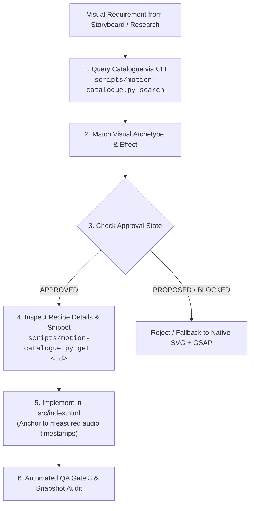

# Motion Library Guide Skill

This skill governs the discovery, vetting, selection, and implementation of motion graphics capabilities, visual effects, and animation recipes across the video production pipeline.

---

## Quick References

- **Catalogue CLI:** Run `python3 scripts/motion-catalogue.py --help` for query and inspection commands.
- **Approval Policy & Licensing:** Read [`references/approval-policy.md`](./references/approval-policy.md) for approval states, licensing rules, and hardware thresholds.
- **Contribution Workflow:** Read [`references/contribution-workflow.md`](./references/contribution-workflow.md) for adding and vetting new libraries or recipes.
- **Recipes Quickstart:** Read [`references/recipes-guide.md`](./references/recipes-guide.md) for immediate GSAP timeline snippets.
- **Design & Layout Rules:** For aesthetic palettes, typography, and canvas grid tokens, consult `motion-graphics-designer`.

---

## 1. When to Use This Skill

Activate this skill whenever you need to:
1. **Identify Capabilities:** Search for existing visual effects, transition recipes, or animation patterns before authoring composition code.
2. **Assess Visual Requirements:** Match abstract pedagogical concepts (e.g. data flow, convergence, consensus) to approved visual archetypes.
3. **Vet Dependencies:** Check whether a candidate animation library is `approved`, `proposed`, or `blocked` before introducing external code.
4. **Implement Tested Recipes:** Retrieve parameterized, deterministic GSAP 3 implementations (zero-dip crossfades, marching dashed lines, signal dots, curve reveals).
5. **Validate Rendering Safety:** Ensure the chosen implementation adheres to the 1280×720 @ 30fps target, single-worker low-memory mode, and $\le$ 1.5 GB RAM cap on Apple Silicon.

---

## 2. Capability Selection Protocol

When choreographing a motion graphics scene in Stage 4:



### Step 1: Search the Catalogue
Execute the search CLI to locate existing solutions:
```bash
# Search by keyword:
python3 scripts/motion-catalogue.py search --query "packet"

# Search approved data-flow effects:
python3 scripts/motion-catalogue.py search --type effect --tag data-flow --status approved
```

### Step 2: Assess Visual Requirements & Match Archetypes
Match the pedagogical goal from `research.json` to an approved effect:
- **Scene Boundaries:** Use `crossfade-dissolve` (`zero-dip-scene-transition`) to eliminate dark dips.
- **Network / Gradient Signals:** Use `traveling-packet` (`node-network-signal-transfer`).
- **Feedback Loops / Backprop:** Use `marching-dashed-stroke` (`backpropagation-flow`).
- **Mathematical Curves / Loss:** Use `clip-path-reveal` (`metric-curve-draw`).
- **Focal Attention / State Change:** Use `glow-pulse` (`active-entity-glow`).
- **Atmospheric Depth:** Use `hybrid-video-underlay` (`cinematic-backdrop-blend`).

### Step 3: Evaluate Approval State & Guardrails
- **NEVER** import or reference a library marked `blocked` (e.g. Anime.js). Redundant animation libraries create timeline contention and waste bundle memory.
- **NEVER** use libraries marked `proposed` (e.g. Three.js) in production explainers without explicit benchmark sign-off.
- **ONLY** use `approved` libraries and recipes for release builds.

### Step 4: Retrieve Recipe Implementation
Inspect the exact parameter schema, timeline requirements, and code snippets:
```bash
python3 scripts/motion-catalogue.py get node-network-signal-transfer
```

### Step 5: Implement with Determinism
1. Mount all tweens to `window.__timelines['root']` created with `{ paused: true }`.
2. Anchor all start times and durations to exact audio timestamps measured via `ffprobe`.
3. NEVER use `Math.random()`. Use seeded `mulberry32` PRNG if procedural variation is needed.

### Step 6: Validate Rendering
1. Run preflight lint: `hyperframes lint index.html`.
2. Render in low-memory mode: `hyperframes render . --fps 30 --low-memory-mode --output renders/visuals.mp4`.
3. Execute automated QA gates: `./.agents/skills/video-assembler/scripts/run-qa-gates.sh renders/final.mp4`.

---

## 3. Separation of Responsibilities

To avoid duplication across skills:
- **`motion-library-guide` (This Skill):** Governs the capability catalogue, dependency approval states, verified licensing, recipe parameters, and contribution workflow.
- **`motion-graphics-designer`:** Governs color palette tokens (Dark Tech, Cyber Cyan), typography rules, 720p/1080p spatial coordinates, and scene layout hierarchy.

