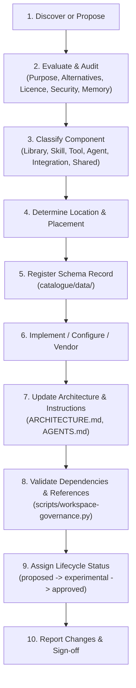

# Component Lifecycle & Governance Standard

This document details the mandatory 10-stage lifecycle for discovering, vetting, installing, registering, modifying, and retiring any workspace component.

---

## The 10-Stage Lifecycle



### Stage 1: Discover or Propose
- An agent or human identifies a missing capability or technical requirement.
- Check existing catalogue first (`python3 scripts/motion-catalogue.py search`).

### Stage 2: Comprehensive Evaluation
- **Purpose:** What exact pedagogical or production problem does this solve?
- **Alternatives:** Can existing tools (GSAP, SVG, FFmpeg, Earshot) achieve this without adding dependencies?
- **Maintenance & Health:** Is the upstream package actively maintained?
- **Licence:** Audit the SPDX licence identifier. Reject viral copyleft or unverified terms.
- **Security & Permissions:** Does it require outbound network, filesystem writes, or binary execution?
- **Hardware Profile:** Does it respect the Apple Silicon M2 8 GB Unified RAM ceiling ($\le$ 1.5 GB render footprint)?

### Stage 3: Classify Component
Assign component type:
- `library`: Browser runtime animation engine or package.
- `skill`: Agent skill under `.agents/skills/`.
- `tool`: CLI executable or developer pipeline script.
- `agent`: Agent or subagent specification.
- `integration`: External service or API connector.
- `shared_asset`: Reusable template or specification.

### Stage 4: Determine Placement
Apply the [Component Placement Policy](./component-placement-policy.md). Never mix ephemeral build outputs with source files.

### Stage 5: Register Schema Record
Create JSON record under `catalogue/data/<collection>/<id>.json` conforming to `catalogue/schemas/`.

### Stage 6: Implement or Configure
Write the code, script, or configuration. Ensure paused timeline mounting, PRNG determinism, and error handling.

### Stage 7: Update Architecture Documentation
If the change materially affects system structure, data flow, or skill responsibilities:
- Update `ARCHITECTURE.md` (flowcharts, directory layout, matrices).
- Update `AGENTS.md` (lifecycle instructions).

### Stage 8: Validate & Drift Check
Run automated audits:
```bash
python3 scripts/workspace-governance.py
```
Must pass with 0 errors.

### Stage 9: Assign Lifecycle Status
- `proposed`: Initial candidate under review.
- `experimental`: Implemented in test bench; undergoing low-memory stress tests.
- `approved`: Formally validated for production explainer releases.
- `deprecated`: Scheduled for phase-out; superseded by lighter alternative.
- `blocked`: Explicitly rejected due to redundancy, non-determinism, or memory violation.

### Stage 10: Report Changes & Sign-off
Summarize files created, tests executed, limitations, and remaining approval requirements.
