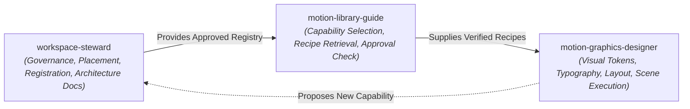

# Workspace Governance Rules & Security Guardrails

This document establishes the non-negotiable operational safety rules and handoff contracts between skills.

---

## 1. Skill Coordination & Clear Handoffs

- **`workspace-steward`**: Owns workspace-wide placement, registration, dependency governance, architecture-document maintenance, and drift auditing.
- **`motion-library-guide`**: Queries the registry to select verified libraries, effects, and animation recipes for scene choreography.
- **`motion-graphics-designer`**: Authors HTML/SVG/GSAP markup implementing selected recipes using aesthetic palette tokens and canvas layout rules.

---

## 2. Operational Safety Principles

1. **No Speculative Third-Party Installations:** Do not install npm/python packages merely to demonstrate governance. Only install packages when explicitly needed and cleared.
2. **Untrusted Installation Guard:** Never execute curl-pipe-bash or uninspected install scripts.
3. **No Secret Ingestion:** Zero secrets in registry records, commit history, or logs.
4. **No Deletion on Deprecation:** Never automatically delete deprecated components; archive them cleanly and migrate dependents first.
5. **Memory Cap Enforcement:** Every browser-rendered component must respect the 1.5 GB RAM ceiling on Apple Silicon 8GB.
