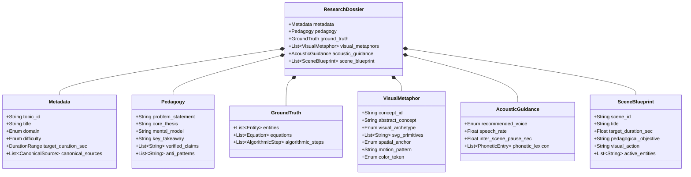
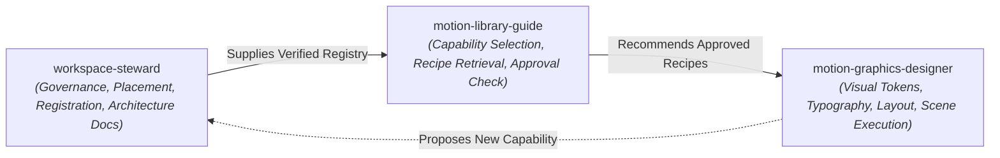

# Motion Graphics Production Pipeline: System Architecture

> **Repository:** this workspace (paths below are repository-relative)  
> **Render host:** Apple Silicon macOS (M2, 8 GB unified memory) with HyperFrames, FFmpeg and Kokoro  
> **Outputs:** short motion pieces in 16:9 (1280×720), 9:16 (720×1280) and 1:1 (1080×1080) at 30 fps (24/25/60 allowed), light themes by default. Legacy technical explainers stay 1280×720 single-format.

Section 0 describes the general-purpose creative studio. Sections 1–7 describe the original technical-explainer pipeline, which still runs unchanged for projects without `project.json`.

---

## 0. Creative Studio Architecture

<a id="lifecycle"></a>

### 0.1 Lifecycle

Each studio project lives in `projects/<slug>/` and is driven by `scripts/studio.py`. A stage that does not apply is switched off in `brief.json`; it is never skipped silently.

| Stage | Artefact | Tools and skills | When |
| --- | --- | --- | --- |
| <a id="s0"></a>0 Brief and creative direction | `brief.json` (`specs/brief-spec.json`): objective, audience, platforms, formats, tone, 1–3 distinct directions, the selected one and why | `motion-graphics-designer` | always |
| <a id="s0r"></a>0R Research | `research.json` + `research.md` | `technical-researcher`, `scripts/validate-research.py` | only when `brief.research.required` (factual topics) |
| <a id="s1"></a>1 Storyboard and style | `storyboard.json` (`specs/storyboard-spec.json`); style system from the catalogue | `motion-graphics-designer`, `motion-library-guide` | standard/complex briefs, or when the template requires it |
| <a id="s2"></a>2 Script | `src/narration.json` | `voice-director` | only with narration |
| <a id="s3"></a>3 Speech and timing | `audio/*.wav`, `audio/timeline.json` | `scripts/build-audio.py` → `src/pipeline/tts.py` | only with narration |
| <a id="s4"></a>4 Composition | `src/index.html` on the vendored runtime `src/_studio/` | `motion-graphics-designer`, `gsap-*`, `kinetic-typography` | always |
| <a id="s4b"></a>4B Sound design | `audio/sfx-track.wav` | `real-sfx`, `earshot` | optional |
| <a id="s5"></a>5 Validate and lint | — | `studio.py validate`; `hyperframes lint` (render host) | always |
| <a id="s6"></a>6 Render per format | `renders/<format>/visuals.mp4` | `hyperframes render --composition index.<format>.html --low-memory-mode` | render host |
| <a id="s7"></a>7 External footage | `assets/generated/` | `scripts/ingest-asset.sh` | optional |
| <a id="s8"></a>8 Assembly | `renders/<format>/final.mp4` → `out/<slug>-<format>.mp4` | `studio.py build` (FFmpeg `amix` of narration, music, SFX) | render host |
| <a id="s9"></a>9 QA | technical gates, `qa/frame-review/`, `qa/creative-review.json` | `run-qa-gates.sh`, `scripts/frame-review.py`, `studio.py review` | always |

```bash
python scripts/studio.py new <slug> --template illustrated-explainer [--style editorial-light] [--formats landscape,portrait,square]
# fill brief.json -> storyboard.json -> src/index.html
python scripts/studio.py validate <slug>
python scripts/frame-review.py <slug> --fonts google      # preview QA on any host with Playwright
python scripts/studio.py build <slug> --dry-run          # prints the per-format plan anywhere
python scripts/studio.py build <slug>                    # render host: render, mux and QA per format
python scripts/studio.py review <slug> --init            # then score qa/creative-review.json
```

<a id="capability-model"></a>

### 0.2 Capability Model

| Layer | Catalogue folder | Examples | Implementation |
| --- | --- | --- | --- |
| Libraries | `catalogue/data/libraries/` | `gsap`, `html-css-native` | CDN or browser-native |
| Primitives | `catalogue/data/primitives/` | `split-text`, `svg-path`, `seeded-particles` | `src/studio/*.js`, `*.css` |
| Effects and recipes | `catalogue/data/effects/`, `recipes/` | `text-mask-rise` / `line-mask-rise`, `liquid-transition` / `liquid-rise` | runtime APIs in `src/studio/` |
| Compositions | `catalogue/data/compositions/` | `title-card`, `item-list`, `step-header`, `end-card`, `caption-band` | `src/studio/studio-compositions.js` |
| Style systems | `catalogue/data/styles/` | `editorial-light` (default), `paper-cut`, `swiss-minimal`, `cinematic-dark`, `dark-tech` | `src/studio/styles/*.css` |
| Project templates | `catalogue/data/project-templates/` | `illustrated-explainer` (others proposed) | `templates/projects/<id>/` |
| Techniques | `catalogue/data/references/` | `pen-led-stroke`, `element-bloom-transition`, `rendered-3d-objects` | runtime APIs named in each record, or a documented capability gap |
| Reference sources | `catalogue/data/reference-sources/` | `ref-92c22222a2` (one record per reference video) | evidence only; the videos stay outside the repository ([0.8](#reference-corpus)) |

Technique records (`catalogue/data/references/`) describe a visual or motion technique: purpose, behaviour, mechanics, parameters, use cases, failure modes, a capability class, provenance (which inspected references show it, and when) and validation evidence. Their lifecycle is derived, not declared: observed → specified → prototyped → tested (preview or render evidence) → approved (render-host evidence only). Status flows proposed → experimental → approved; `motion-catalogue.py validate` rejects dependencies on less mature components. New components start as experimental and are promoted only after a HyperFrames render on the render host. Search across all layers with `python scripts/motion-catalogue.py search "<intent>" --type effect|recipe|primitive|composition|template|style|technique|source`; `recommend --brief projects/<slug>/brief.json` ranks techniques, precedents and styles for a brief.

<a id="runtime"></a>

### 0.3 Studio Runtime

`src/studio/` is canonical: `studio-core.js` (format, safe area, seeded randomness, timeline registration, scene switches), `studio-draw.js`, `studio-type.js`, `studio-motion.js`, `studio-compositions.js`, `studio-base.css` and `styles/`. HyperFrames serves only the project folder, so `studio.py sync` copies the runtime into `projects/<slug>/src/_studio/` with `studio.lock.json` (SHA-256 per file). Local edits there are rejected: change `src/studio/` and re-sync.

Determinism rules (linted by `studio.py validate`): one paused GSAP timeline registered last through `Studio.build`; no `Math.random`, wall-clock time, timers, `requestAnimationFrame` or infinite repeats; entrances use `fromTo` with `immediateRender`; scene visibility switches 1 ms after the cue so backward seeks restore state; fonts are HyperFrames-bundled families or declared with `@font-face`. Self-test: `tests/test-studio-runtime.py`.

<a id="formats"></a>

### 0.4 Formats and Layout

`specs/format-presets.json` defines landscape 16:9 (1280×720 default, 1080p, 4K), portrait 9:16 (720×1280 default, 1080×1920), square 1:1 (1080×1080), frame rates 24/25/30/60, safe areas per format and the text floor (2.6 % of the short side). Authors write one `src/index.html` for the primary format; `studio.py formats` writes `src/index.<format>.html` with the root size and CSS variables (`--w`, `--h`, `--u` = 1 % of the short side, `--safe-*`). Layout adapts through `#root[data-format=…]` rules and `Studio.pick({landscape, portrait, square})`, so each format is composed rather than cropped. HyperFrames cannot change aspect ratio at render time, hence one entry file per format. Generated files are tracked; validation and governance fail when they are stale.

<a id="video-spec"></a>

### 0.5 Project Configuration

`project.json` (`specs/video-spec.json`, v2) holds the template, style system, formats (primary and optional safe-area overrides), fps, duration, quality, timing source (narration, music or fixed), audio (narration on or off, voice, speed, licensed music, SFX, captions, loudness target) and runtime version. Projects without `project.json` are legacy explainers: `studio.py build` delegates them to `scripts/build-project.sh`, and `build-project.sh` hands studio projects to `studio.py build`.

### 0.6 Quality Assurance

- **Technical:** `run-qa-gates.sh` (streams, loudness, black gaps, container, Earshot). `studio.py build` passes `--expect-width/--expect-height/--expect-fps/--expect-duration`, `--expect-lufs` when audio exists, or `--allow-silent`; mismatches exit 2. Without flags the script stays informational for legacy builds.
- **Preview:** `scripts/frame-review.py` seeks every format in headless Chromium and flags clipped or overlapping text, text below the floor, safe-area violations, estimated low contrast, dead stretches, blank frames and unread lines. It writes contact sheets and `contact-matrix.png` to `qa/frame-review/`; only `report.json` and the matrix are tracked.
- **Creative:** `qa/creative-review.json` scores 12 criteria from 1 to 5 with evidence; it passes when every score is at least 3 and the mean is at least 3.5. Automated checks do not replace looking at frames.

<a id="verification-status"></a>

### 0.7 Verification Status (2026-10-30)

| Item | Where | Result |
| --- | --- | --- |
| Runtime self-test (`tests/test-studio-runtime.py`) | Windows, Playwright Chromium | pass |
| Studio CLI, QA gates, build delegation (`tests/test-studio.py`) | Windows, Git Bash with stub ffprobe/ffmpeg | 21 tests pass |
| Catalogue validation and governance gates | Windows | catalogue pass (10 libraries, 34 effects, 34 recipes, 13 primitives, 5 compositions, 8 templates, 5 styles, 7 references); governance 7/7 gates pass, 1 warning (`.venv/bin/earshot` absent on this host) |
| `projects/masala-chai-recipe`: validate, frame review in 3 formats, creative review | Windows | 0 errors, 0 warnings; review mean 3.92 (preview grade) |
| Legacy regression (`benchmark-neural-network` and the other three explainers) | Windows | files unchanged; research dossiers validate; frame review 0 errors (67 pre-existing small-label warnings); `studio.py build --dry-run` delegates to `build-project.sh` |
| `tests/test-audio-stack.py` | Windows | fails: Earshot and FFmpeg are not installed on this host (environment, not this change) |
| HyperFrames lint/check/render, FFmpeg mux, loudness, Earshot | not run | tools absent on the Windows host; required on the M2 before promoting any experimental component |
| Fonts in frame review | Google Fonts CSS stand-ins | rasterisation may differ from HyperFrames' bundled fonts |

<a id="reference-corpus"></a>

### 0.8 Reference Corpus and Technique Knowledge Base

Reference videos teach techniques; they are never source material. `scripts/reference-corpus.py` and the `reference-analyst` skill turn a folder of user-supplied videos into reviewed, searchable knowledge that projects reuse.

| Layer | Location | Tracked | Written by |
| --- | --- | --- | --- |
| Videos | outside the repository, found through `--root DIR` or `MOTION_REFERENCE_ROOTS` | never | the user |
| Analysis cache: sampled frames, overview/scene/transition/motion sheets, audio panel, `signal.json` | `out/reference-analysis/<id>/` | never (third-party imagery, possibly brand marks) | `reference-corpus.py analyze` |
| Source record: file name, size, SHA-256, rights and brand assets, `media` and `automated` evidence, the analyst's notes | `catalogue/data/reference-sources/ref-<sha256[:10]>.json` (`reference-source.schema.json`) | yes | the tool writes `media` and `automated` only; the analyst writes `analysis`, `techniques`, `rights`, `categories` |
| Technique record | `catalogue/data/references/<id>.json` (`reference.schema.json`) | yes | the analyst |
| Implementation | runtime APIs in `src/studio/` plus effect, recipe and composition records | yes | development |
| Evidence | `tests/studio-runtime/reference-techniques.html`, `tests/reference-derived/<name>/`, demo projects, `benchmark.json` | yes (reports and contact sheets, not sampled frames) | tests, `frame-review.py`, `tests/reference-derived/benchmark.py` |

**Measurement versus judgement.** The tool measures: MP4 boxes parsed in pure Python (no ffprobe), content hash, cuts and soft transitions (coarse scan, frame-accurate refinement, a cut must be an isolated single-frame change), static holds, palette, motion windows, audio onsets, tempo and cut-to-onset/beat alignment against chance. The analyst judges: concept, typography, easing, motifs, techniques and rights, with observations kept apart from interpretations and a confidence per note. Re-running the tool never overwrites the analyst's blocks.

**Capability classes** (`capability.support` on every technique): `native` (existing runtime and HyperFrames), `approximation` (a cheaper stand-in with stated limits, e.g. smear for motion blur), `additional-dependencies` (needs a tool outside the runtime, e.g. Blender pre-renders), `resource-constrained` (possible but too heavy for the 8 GB host as specified), `research-required` (no credible approach yet). `reference-corpus.py report --backlog` lists unsupported or unimplemented techniques by creative value, frequency and cost.

**Validation rules** (`motion-catalogue.py validate`): provenance may cite only inspected sources, with timestamps inside the video; source and technique links are two-way; preview or render validation needs evidence and an implementation; `approved` needs render-host evidence; measured resources need measurements; source IDs must match their hash; `inspiration-only` sources may not authorise brand assets. `studio.py validate` checks `brief.references[].technique_ids` and warns when a project leans on a technique that is only observed or specified.

**Adding a video.**

```bash
python scripts/reference-corpus.py ingest "<file-or-folder>"                 # hash, probe, create or alias records
python scripts/reference-corpus.py analyze --pending --root "<folder>"       # evidence into out/reference-analysis/<id>/
# look at overview/scenes/transitions/motion/audio sheets, then write analysis + techniques (reference-analyst skill)
python scripts/reference-corpus.py check --name "<candidate technique>"      # extend an existing record when it is a duplicate
python scripts/motion-catalogue.py validate
python scripts/reference-corpus.py report --backlog
```

**Rights.** Every source defaults to `inspiration-only` with unknown licence. Logos, wordmarks, characters, product UI, footage and exact shot sequences are recorded as `brand_assets` with policy `exclude`; demos and projects reuse principles with original copy, drawing and choreography. Nothing from the cache or the videos may be committed or used as an asset.

**Cost.** Analysis runs at about 0.5x real time on the Windows dev host with the Edge decoder (one headless Edge, roughly 0.8 GB working set observed); the FFmpeg backend is implemented but untested. On the M2, analyse one video at a time and never alongside a render.

---

## 1. End-to-End System Flowchart

The pipeline balances **AI creativity & technical research (LLM)** for research, scripting, and code generation with **deterministic local engines (Kokoro, HyperFrames, FFmpeg)** for audio synthesis, frame-accurate rendering, and quality assurance.

```mermaid
flowchart TD
    subgraph S0["Stage 0: Topic Research & Technical Investigation"]
        Topic["Topic Prompt / Technical Concept"] --> LLM_Research["LLM Analyst / Research Subagent<br/><i>(Literature retrieval, whitepapers, arXiv, docs)</i>"]
        LLM_Research --> FactCheck["Technical Truth & Algorithm Tracing<br/><i>(Formula verification, state machines, edge cases)</i>"]
        FactCheck --> MetaphorMap["Mental Model & Visual Metaphor Design<br/><i>(Abstract math/data to 2D visual primitives)</i>"]
        MetaphorMap --> ResearchJSON["research.json<br/><i>(Strict Schema specs/research-spec.json)</i>"]
        MetaphorMap --> ResearchMD["research.md<br/><i>(Human & LLM Readable Dossier)</i>"]
        ResearchJSON --> ValidateResearch["scripts/validate-research.py<br/><i>(Automated schema validation gate)</i>"]
    end

    subgraph S1["Stage 1: Curriculum & Storyboard Design"]
        ValidateResearch --> LLM_Outline["LLM: Pedagogical Designer<br/><i>(Structures 3-5 progressive learning scenes)</i>"]
        LLM_Outline --> Storyboard["Storyboard Outline<br/><i>(Core claim + visual action per scene)</i>"]
    end

    subgraph S2["Stage 2: Scriptwriting & Phonetics"]
        Storyboard --> LLM_Script["LLM: Voice Scriptwriter<br/><i>(Applies voice-director skill & phonetics)</i>"]
        ResearchJSON -.-> LLM_Script
        LLM_Script --> NarrationJSON["narration.json<br/><i>(Scene text + voice persona)</i>"]
    end

    subgraph S3["Stage 3: Speech Synthesis & Audio Pacing"]
        NarrationJSON --> Kokoro["Local Kokoro 0.9.4 TTS<br/><i>(PyTorch + misaki + espeak-ng)</i>"]
        Kokoro --> AudioClips["audio/s*.wav<br/><i>(24kHz mono PCM WAV)</i>"]
        AudioClips --> ConcatWav["FFmpeg Concat + 0.5s pause.wav buffers"]
        ConcatWav --> FullAudio["audio/narration-full.wav"]
        AudioClips --> Measure["ffprobe Millisecond Duration Measurement"]
        Measure --> Timestamps["Exact Timeline Map<br/>(T_s1, T_s2, T_s3, T_s4, T_end)"]
    end

    subgraph S4["Stage 4: Visual Choreography & Coding"]
        Timestamps --> LLM_Motion["LLM: Motion Graphics Engineer<br/><i>(Applies motion-library-guide & motion-graphics-designer skills)</i>"]
        ResearchJSON -.-> LLM_Motion
        LLM_Motion --> IndexHTML["src/index.html<br/><i>(HTML5 + SVG + GSAP 3 + PRNG)</i>"]
    end

    subgraph S4B["Stage 4B: Sound Design & Foley Choreography"]
        IndexHTML --> HyperExtract["from_hyperframes.py<br/><i>(Detects visual onsets, bursts, cuts)</i>"]
        HyperExtract --> MomentsJSON["renders/moments.json"]
        MomentsJSON --> CueSuggest["suggest_cues.py<br/><i>(Roles: whoosh, click, pop, impact)</i>"]
        CueSuggest --> CuesJSON["renders/cues.json"]
        OpenverseAPI["Openverse CC Catalog<br/><i>(scripts/sfx-openverse.py)</i>"] --> SFXLib["assets/audio/sfx/"]
        EarshotBank["Earshot Procedural Bank<br/><i>(earshot sfx / forge)</i>"] --> SFXLib
        SFXLib --> RealMixer["real-sfx mix.py<br/><i>(Deterministic multi-track placement)</i>"]
        CuesJSON --> RealMixer
        RealMixer --> SFXTrack["audio/sfx-track.wav"]
    end

    subgraph S5["Stage 5: Static Analysis & Linting"]
        IndexHTML --> HFLint["hyperframes lint index.html"]
        HFLint -->|Errors Found| LLM_Fix["LLM: Automated Patching"]
        LLM_Fix --> IndexHTML
        HFLint -->|Clean / 0 Errors| LintPassed["Composition Ready"]
    end

    subgraph S6["Stage 6: Visual Track Rendering"]
        LintPassed --> HFRender["HyperFrames Headless Chromium<br/><i>(--low-memory-mode, 1 worker, ANGLE Metal GPU)</i>"]
        HFRender --> VisualsMP4["renders/visuals.mp4<br/><i>(Silent H.264 video track)</i>"]
    end

    subgraph S7["Stage 7: Optional Cinematic Blending (Veo)"]
        VeoWeb["User / Google Flow Web UI<br/><i>(Prompt: Cinematic 3D Background)</i>"] -.-> RawVeo["assets/generated/raw.mp4"]
        RawVeo -.-> Ingest["scripts/ingest-asset.sh<br/><i>(Normalizes to 720p 30fps silent)</i>"]
        Ingest -.-> LayerVeo["Layered under SVG via &lt;video&gt;"]
        LayerVeo -.-> IndexHTML
    end

    subgraph S8["Stage 8: Multiplexing & Assembly"]
        VisualsMP4 --> Mux["FFmpeg Multi-Track Assembly<br/><i>(amix voice + sfx, -c:v copy -c:a aac -b:a 192k)</i>"]
        FullAudio --> Mux
        SFXTrack --> Mux
        Mux --> FinalMP4["renders/final.mp4<br/>& out/project-name.mp4"]
    end

    subgraph S9["Stage 9: Automated QA Gates & Visual Verification"]
        FinalMP4 --> QAScript["scripts/run-qa-gates.sh"]
        QAScript --> EBUR128["Gate 2: EBU R128 (-21.2 LUFS)"]
        QAScript --> BlackDetect["Gate 3: Blackdetect Gap Audit"]
        QAScript --> EarshotQA["Gate 5: Earshot Acoustic & Spectral Audit"]
        QAScript --> Snapshots["hyperframes snapshot --at timestamps"]
        Snapshots --> LLM_Inspect["LLM: Visual Inspection<br/><i>(Verifies contrast, fonts, layout, seams)</i>"]
        EarshotQA --> SignOff
        LLM_Inspect --> SignOff["Production Certified Delivery"]
    end

    classDef llm fill:#2d1b4e,stroke:#9d4edd,stroke-width:2px,color:#f8f9fa;
    classDef deterministic fill:#142850,stroke:#00a8cc,stroke-width:2px,color:#f8f9fa;
    classDef media fill:#1b4332,stroke:#40916c,stroke-width:2px,color:#f8f9fa;
    classDef human fill:#4a2800,stroke:#e85d04,stroke-width:2px,color:#f8f9fa;

    class LLM_Research,FactCheck,MetaphorMap,LLM_Outline,LLM_Script,LLM_Motion,LLM_Fix,LLM_Inspect llm;
    class ValidateResearch,Kokoro,Measure,ConcatWav,HFLint,HFRender,Mux,QAScript,EBUR128,BlackDetect,Snapshots deterministic;
    class ResearchJSON,ResearchMD,Storyboard,NarrationJSON,AudioClips,FullAudio,Timestamps,IndexHTML,VisualsMP4,FinalMP4 media;
    class VeoWeb human;
```



---

## 2. Component Responsibility Matrix: LLM vs. Deterministic Tools

| Pipeline Component | Role / Tool | Requires LLM? | Why / Rationale |
|---|---|:---:|---|
| **-1. Workspace Governance & Registration** | `workspace-steward` + `scripts/workspace-governance.py` | **PARTIAL** | Enforces 7-domain component placement, schema registration, licensing verification, and automated zero-drift auditing. |
| **0. Topic Research & Technical Investigation** | Literature search, math verification, visual metaphor design | **YES** | Synthesizes complex technical subjects into verified mathematical models, step-by-step state traces, and intuitive visual representations. Eliminates factual hallucinations before scripting. |
| **1. Research Schema Validation** | `scripts/validate-research.py` + `specs/research-spec.json` | **NO** | Deterministic JSON Schema Draft-07 validation ensuring all required research dimensions exist before authoring begins. |
| **2. Pedagogical Scoping & Storyboarding** | Concept structuring & curriculum flow | **YES** | Translates research dossier into 3–5 progressive learning scenes matching target runtime constraints. |
| **3. Scriptwriting & Phonetics** | Spoken narration authoring | **YES** | Writes concise, conversational educational scripts matching pacing limits and applying phonetic respellings for technical jargon. |
| **4. Speech Synthesis** | Local Kokoro TTS 0.9.4 | **NO** | Deterministic neural synthesis on Python 3.12 (24 kHz PCM WAV). Free, local, zero LLM hallucination risk. |
| **5. Audio Timing Measurement** | `ffprobe` / `wave` | **NO** | Exact millisecond duration measurement of rendered audio chunks. Establishes immutable timeline anchor points. |
| **6. Motion Graphics Code** | GSAP 3 + SVG HTML authoring (`motion-library-guide` + `motion-graphics-designer` + `gsap-skills` + `motion-design` + `kinetic-typography` + `epic-design` + `collage-design` + `algorithmic-art`) | **YES** | Vets capabilities via capability catalogue, applies Disney motion principles, and authors GSAP timelines anchored to audio timestamps. |
| **7. Deterministic PRNG** | `mulberry32` algorithm | **NO** | Mathematical pseudorandom number generator ensuring identical frame renders across runs. |
| **8. Composition Linting** | `hyperframes lint` | **NO** | Static analysis CLI checking for syntax errors, DOM validity, and tween overlaps. |
| **9. Visual Rendering** | HyperFrames + Chromium | **NO** | Headless Chrome engine running with ANGLE Metal GPU acceleration. |
| **10. Cinematic Footage (Optional)** | Google Veo / Flow (Web UI) | **NO / Human** | External video generation via consumer browser interface; normalized via `./scripts/ingest-asset.sh`. |
| **11. Sound Design & Foley Sourcing** | Openverse (`sfx-openverse.py`) + Real SFX (`real-sfx`) + Earshot (`earshot forge`/`sfx`) | **PARTIAL** | Sourcing open-source CC assets via Openverse REST API, procedural synthesis with Earshot, and frame-accurate placement on HyperFrames cues via Real SFX. |
| **12. Multi-Track Stream Assembly** | FFmpeg stream multiplexer (`amix` filter complex) | **NO** | Lossless multiplexing of silent visual track with voice narration and sound effects bed (<0.5s runtime). |
| **13. Acoustic, Gap & Sync QA** | FFmpeg filters (`ebur128`, `blackdetect`) + Earshot (`earshot measure`) | **NO** | Mathematical measurement of loudness (-21.2 LUFS), peak clipping, spectral bandwidth, and luminance dropouts. |
| **14. Frame Verification** | Multimodal frame review | **YES** | Visual evaluation of contact sheets and extracted frames to verify contrast, typography, and absence of visual bugs. |

---

## 3. Standardized Research Data Model & Schema

To guarantee predictability across any technical or scientific topic, every project produces a formal research dossier in dual formats:
1. **`research.json`**: Machine-readable data model strictly validated against [`specs/research-spec.json`](file:///Users/mahavir/Downloads/Repo/motion%20graphics/specs/research-spec.json). Consumed programmatically by script generators, voice synthesis, and GSAP timeline scaffolders.
2. **`research.md`**: Human- and LLM-readable narrative dossier generated from [`templates/research-template.md`](file:///Users/mahavir/Downloads/Repo/motion%20graphics/templates/research-template.md) containing KaTeX math equations, visual metaphor tables, and storyboards.

### 3.1 The 6 Core Pillars of the Research Schema



### 3.2 Schema Field Definitions

| Pillar | Key Field | Type / Constraints | Downstream Consumer & Purpose |
|---|---|---|---|
| **`metadata`** | `topic_id` | Kebab-case string (e.g. `raft-consensus`) | Directory and output file naming conventions. |
| | `domain` | Enum (`deep_learning`, `distributed_systems`, etc.) | Determines color palette defaults and visual archetype presets. |
| | `target_duration_sec` | `{ min, max, target }` | Bounds script word count and animation timelines. |
| | `canonical_sources` | List of citations with URLs | Anti-hallucination source grounding. |
| **`pedagogy`** | `core_thesis` | 1–2 sentences | Governs the narrative focus of Scene 1 and Scene 4. |
| | `mental_model` | Spatial/physical analogy | Informs GSAP visual choreographies (avoids sterile floating diagrams). |
| | `verified_claims` | Array of strings | Checklist verified in Stage 9 QA. |
| | `anti_patterns` | Array of strings | Prevents misleading analogies or technical misrepresentations. |
| **`ground_truth`** | `entities` | LaTeX symbols, names, roles | Rendered as text nodes or KaTeX math labels in SVG. |
| | `equations` | LaTeX, spoken form, derivation context | Spoken form directly feeds Stage 2 narration scriptwriting. |
| | `algorithmic_steps` | Ordered state transitions | Determines sequence of scene transitions and state triggers. |
| **`visual_metaphors`**| `visual_archetype`| Enum (`node_network_graph`, `curved_landscape_descent`, etc.) | Selects reusable SVG layouts from `motion-graphics-designer` skill. |
| | `svg_primitives` | List (`circle`, `path`, `rect`, `filter`) | Scaffolds initial DOM elements in `src/index.html`. |
| | `spatial_anchor` | Enum (`canvas_center`, `three_column_layers`, etc.) | Canvas coordinate budget preventing visual overlap. |
| | `motion_pattern` | GSAP pattern description | Guides timeline tween construction (drawSVG, scale pulse, etc.). |
| | `color_token` | Palette token enum | Maps directly to CSS custom properties in the composition. |
| **`acoustic_guidance`**| `recommended_voice` | Enum (`am_adam`, `af_bella`, etc.) | Passed directly to `src/pipeline/tts.py --voice`. |
| | `speech_rate` | Float (`0.75` - `1.25`, default `0.95`) | Passed to TTS engine to tune pacing for dense explanations. |
| | `phonetic_lexicon`| Terms + phonetic respellings | Automatically ingested by Stage 2 to replace jargon in `narration.json`. |
| **`scene_blueprint`**| `scene_blueprint` | Array of 3–5 scene objects | Establishes target scene IDs (`s1`–`s4`), scene boundaries, and visual actions. |

### 3.3 Automated Research Validation CLI

Before drafting scripts or code, any research dossier must pass validation:

```bash
# Validate a specific research.json:
python3 scripts/validate-research.py projects/<project_name>/research.json

# Or validate by project directory:
python3 scripts/validate-research.py projects/benchmark-neural-network
```

---

## 4. Step-by-Step Production Runbook

### Step 0: Topic Research & Technical Investigation
- **Owner:** LLM Technical Analyst / Research Subagent
- **Input:** Raw topic idea, engineering problem, algorithm, or scientific concept from user.
- **Protocol:**
  1. **Canonical Literature & Documentation Retrieval:** Locate primary sources (original papers, RFCs, official architecture docs, source code) to ensure conceptual grounding.
  2. **Mathematical & Algorithmic Tracing:** Formulate exact formulas (in LaTeX) and step-by-step state machine transitions (e.g., $w_{t+1} = w_t - \eta \nabla L$).
  3. **Anti-Hallucination Fact-Checking:** Verify definitions, constants, and execution semantics against primary sources before any script text is drafted. Reject hand-wavy analogies that mislead technical audiences.
  4. **Visual Metaphor Formulation:** Design concrete 2D geometric and spatial mappings for abstract concepts (e.g., weights $\to$ line stroke widths/opacities; loss $\to$ landscape elevation; tokens $\to$ color-coded vector chips).
  5. **Phonetic & Jargon Identification:** Extract domain terminology, acronyms, and math symbols that require phonetic substitution (e.g., $\nabla \to$ "grad", ReLU $\to$ "ray-loo").
- **Deliverables:**
  - `projects/<project_name>/research.json` (Validated against [`specs/research-spec.json`](file:///Users/mahavir/Downloads/Repo/motion%20graphics/specs/research-spec.json))
  - `projects/<project_name>/research.md` (Rich dossier formatted via [`templates/research-template.md`](file:///Users/mahavir/Downloads/Repo/motion%20graphics/templates/research-template.md))
- **Gate:** Run `python3 scripts/validate-research.py projects/<project_name>` (Must exit with 0 errors).

---

### Step 1: Script & Scene Definition
- **Owner:** LLM + `voice-director` skill
- **Input:** Validated `projects/<project_name>/research.json` and `research.md`.
- **Action:** Generates `projects/<project_name>/src/narration.json` containing scene IDs, titles, and text scripts matching the `scene_blueprint`.
- **Rule:** Technical terms are phonetically respelled using the `phonetic_lexicon` from the research dossier (e.g., *ReLU* → `"ray-loo"`, *backpropagation* → `"back propagation"`).

---

### Step 2: Speech Synthesis & Audio Measurement
- **Owner:** Deterministic (`src/pipeline/tts.py` or `.agents/skills/voice-director/scripts/synth-and-measure.py`)
- **Command:**
  ```bash
  python3.12 src/pipeline/tts.py --text "<scene text>" --out audio/s1.wav --voice am_adam --speed 0.95
  ```
- **Action:**
  1. Synthesizes each scene to `audio/s1.wav`, `audio/s2.wav`, etc.
  2. Measures exact audio duration using `ffprobe`.
  3. Inserts a `0.5s` silence buffer (`audio/pause.wav`) between clips.
  4. Concatenates all scenes into `audio/narration-full.wav`.
- **Output:** Exact timeline table ($T_0, T_1, T_2, \dots$).

---

### Step 3: Motion Graphics Composition Coding
- **Owner:** LLM + `motion-graphics-designer` skill
- **Input:** Measured timeline timestamps + visual concepts and archetypes from `research.json`.
- **File:** `projects/<project_name>/src/index.html`
- **Mandatory Requirements:**
  1. Set `data-width="1280"`, `data-height="720"`, `data-fps="30"`, `data-duration="<narration_duration>"`.
  2. Instantiate GSAP timeline with `{ paused: true }` and assign to `window.__timelines['root']`.
  3. Never use `Math.random()`. Use seeded `mulberry32` PRNG.
  4. Synchronize scene crossfades using `sceneFade(outId, inId, atTime)` to prevent dark frame dips.

---

### Step 3B: Sound Design, Foley Choreography & Acoustic Verification
- **Owner:** Deterministic + LLM Sound Designer (`real-sfx`, `earshot`, `openverse`)
- **Protocol:**
  1. **Visual Moment Extraction:** Parse DOM elements and GSAP tweens from `index.html` to extract frame-accurate timestamps for entrances, burst scales, and scene cuts:
     ```bash
     .venv/bin/python .agents/skills/real-sfx/scripts/from_hyperframes.py src/index.html --video renders/visuals.mp4 --out renders/moments.json
     ```
  2. **Asset Sourcing & Generation:**
     - Query Openverse for free Creative Commons sound assets:
       ```bash
       python3 scripts/sfx-openverse.py "whoosh transition" --limit 5 --download --out-dir assets/audio/sfx
       ```
     - Procedurally generate micro-SFX (UI clicks, thocks, cut hits) via Earshot:
       ```bash
       .venv/bin/earshot sfx render click/thock -o assets/audio/sfx/thock.wav
       ```
  3. **Sound Cue Planning:** Map extracted moments to audio roles (whoosh, click, pop, impact) with target levels:
     ```bash
     .venv/bin/python .agents/skills/real-sfx/scripts/suggest_cues.py renders/moments.json --out renders/cues.json
     ```
  4. **Multi-Track Mixing:** Render deterministic audio bed beneath voice narration:
     ```bash
     .venv/bin/python .agents/skills/real-sfx/scripts/mix.py renders/cues.json --out renders/film_sfx.mp4
     cp renders/film_sfx_sfx_track.wav audio/sfx-track.wav
     ```
  5. **Soundtrack Self-Critique:** Audit acoustic quality against calibrated benchmarks:
     ```bash
     .venv/bin/python .agents/skills/real-sfx/scripts/critique.py renders/film_sfx_resolved_cues.json audio/sfx-track.wav
     ```
     Verifies sync (10.0/10), initial hook (<2s), headroom, and stereo-to-mono compatibility.

---

### Step 4: Linting & Preflight Checks
- **Owner:** Deterministic (`hyperframes lint`)
- **Command:**
  ```bash
  cd projects/<project_name>/src && hyperframes lint index.html
  ```
- **Rule:** Must exit with 0 errors before rendering proceeds.

---

### Step 5: Visual Track Render
- **Owner:** Deterministic (HyperFrames + ANGLE Metal GPU)
- **Command:**
  ```bash
  hyperframes render . --fps 30 --quality looks --low-memory-mode --output ../renders/visuals.mp4
  ```
- **Hardware Rule (M2 8 GB RAM):** Always pass `--low-memory-mode`. This pins the worker pool to 1 and forces screenshot capture mode, keeping RAM usage below 1.5 GB.

---

### Step 6: Audio-Video Multiplexing
- **Owner:** Deterministic (FFmpeg)
- **Command:**
  ```bash
  # When sound design bed (sfx-track.wav) is present:
  ffmpeg -y \
    -i ../renders/visuals.mp4 \
    -i ../audio/narration-full.wav \
    -i ../audio/sfx-track.wav \
    -filter_complex "[1:a]volume=1.0[a_voice];[2:a]volume=0.85[a_sfx];[a_voice][a_sfx]amix=inputs=2:duration=first:dropout_transition=2[aout]" \
    -map 0:v -map "[aout]" \
    -c:v copy -c:a aac -b:a 192k -shortest ../renders/final.mp4

  # Fallback (narration only):
  ffmpeg -y -i ../renders/visuals.mp4 -i ../audio/narration-full.wav -c:v copy -c:a aac -b:a 192k -shortest ../renders/final.mp4
  ```
- **Result:** Fast stream multiplexing with ducked sound effects layer beneath clear speech narration.

---

### Step 7: Automated QA Gates
- **Owner:** Deterministic (`.agents/skills/video-assembler/scripts/run-qa-gates.sh`)
- **Command:**
  ```bash
  ./.agents/skills/video-assembler/scripts/run-qa-gates.sh projects/<project_name>/renders/final.mp4
  ```
- **Verification Gates:**
  1. **Gate 1 (Codec / Streams):** Video is H.264 High Profile (yuv420p) at 1280×720 @ 30fps; Audio is AAC-LC.
  2. **Gate 2 (Loudness):** Integrated loudness measures -21.2 LUFS (±2 LU tolerance) via EBU R128 filter.
  3. **Gate 3 (Black Screen Audit):** Zero unintentional dark gaps during scene crossfades (`blackdetect`).
  4. **Gate 4 (Container Metrics):** Bitrate and duration verification via FFprobe.
  5. **Gate 5 (Earshot Acoustic Verification):** Objective measurement of true peak (< -1.0 dBTP), noise floor (< -50 dBFS), attack/decay times, and spectral energy distribution.

---

### Step 8: Visual Quality Inspection
- **Owner:** LLM Multimodal Vision
- **Command:**
  ```bash
  hyperframes snapshot . --at 3.0,10.0,18.0,25.0 --output ../renders/snapshots
  ```
- **Action:** Review rendered frames via multimodal tool calls (`read_file`) to check typography, alignment, contrast, and absence of visual bugs.

---

## 5. Scalable Directory Layout

```text
/Users/mahavir/Downloads/Repo/motion graphics/
├── ARCHITECTURE.md                    # System architecture & component flow (this file)
├── README.md                          # Quickstart guide & environment setup
├── AGENTS.md                          # AI agent operating guidelines
├── init-prompt.md                     # Original mission initialization brief
│
├── .venv/                             # Local Python 3.12 environment (PyTorch, Earshot, Librosa)
│
├── specs/                             # Machine-readable schemas
│   ├── research-spec.json             # Stage 0: Research dossier JSON Schema (Draft-07)
│   ├── video-spec.json                # Video composition specifications
│   └── architecture.md
│
├── templates/                         # Production scaffolding templates
│   ├── research-template.json         # Reusable research data model instance
│   └── research-template.md           # Reusable Markdown dossier template
│
├── catalogue/                         # Workspace & Motion Capability Catalogue
│   ├── README.md                      # Catalogue documentation & contribution guide
│   ├── index.json                     # Aggregated capability registry manifest
│   ├── schemas/                       # Draft-07 JSON Schemas (library, effect, recipe, component)
│   └── data/                          # Modular atomic records (8 collections)
│       ├── libraries/                 # Runtime dependencies & browser primitives
│       ├── effects/                   # Visual effect archetypes
│       ├── recipes/                   # Parameterized GSAP 3 animation snippets
│       ├── skills/                    # Registered agent skills
│       ├── tools/                     # Registered CLI tools & developer utilities
│       ├── agents/                    # Registered agents & subagents
│       ├── integrations/              # External service integrations
│       └── shared/                    # Shared templates & specifications
│
├── .agents/skills/                    # Specialized AI skills
│   ├── workspace-steward/             # Governance, placement policy, drift detection
│   ├── technical-researcher/          # Topic research, math truth, visual metaphors
│   ├── motion-library-guide/          # Capability catalogue search, vetting, recipes
│   ├── motion-graphics-designer/      # Colors, typography, GSAP 3 patterns
│   ├── kinetic-typography/            # Headline mask reveals, variable fonts, accessibility
│   ├── motion-design/                 # Disney animation principles, easing, staging
│   ├── epic-design/                   # Cinematic 2.5D pseudo-3D, 6-layer depth system
│   ├── collage-design/                # Procedural torn paper, mixed-media, SVG filters
│   ├── algorithmic-art/               # Deterministic flow fields, generative art, math curves
│   ├── voice-director/                # Voice personas, phonetics, audio pacing
│   ├── real-sfx/                      # Sound design, HyperFrames cue extraction, multi-track mixing
│   ├── earshot/                       # Acoustic listening, spectral checks, procedural SFX
│   └── video-assembler/               # Memory safety, FFmpeg assembly, QA gates
│
├── tools/                             # Vendored toolkits
│   ├── earshot/                       # Open-source Earshot repository (Leonxlnx/earshot)
│   └── clipwing-skills/               # Open-source Clipwing skills repository
│
├── projects/                          # Modular video workspaces
│   ├── benchmark-neural-network/      # Explainer 1: Deep Learning & Gradient Descent (V2)
│   │   ├── research.json              # Validated research data model
│   │   ├── research.md                # Human & LLM readable research dossier
│   │   ├── src/
│   │   │   ├── index.html             # Composition source
│   │   │   └── narration.json         # Scene script text
│   │   ├── audio/                     # Synthesized narration and SFX tracks
│   │   └── renders/                   # Working renders, snapshots, validation frames
│   │
│   ├── distributed-consensus-raft/    # Explainer 2: Raft Consensus & Log Replication
│   └── btree-database-indexing/       # Explainer 3: B-Trees & Storage Engine Geometry
│
├── out/                               # Final distribution deliverables & showcase
│   ├── index.html                     # HTML5 interactive video portfolio gallery
│   ├── posters/                       # Standalone preview posters for all explainers
│   ├── benchmark-neural-network-v2.mp4
│   ├── distributed-consensus-raft.mp4
│   └── btree-database-indexing.mp4
│
├── assets/                            # Global shared assets
│   ├── audio/                         # Sound effects, ambient tracks
│   │   └── sfx/                       # Openverse / CC0 downloaded SFX library
│   ├── images/                        # Vector SVGs, icons, logos
│   └── generated/                     # External AI video clips (Veo)
│
├── scripts/                           # Reusable production automation
│   ├── build-all.sh                   # Sequential batch portfolio builder & QA verifier
│   ├── build-project.sh               # Full-lifecycle production orchestrator (0->9)
│   ├── build-audio.py                 # Automated Kokoro TTS & timeline map generator
│   ├── sfx-openverse.py               # Openverse CC audio search and asset downloader
│   ├── new-project.sh                 # Scaffolds new projects from schema & templates
│   ├── render.sh                      # Single-command render and mux builder
│   ├── validate-research.py           # Research schema validator (Draft-07)
│   └── ingest-asset.sh                # Normalizer for external Veo/stock video
│
├── src/                               # Shared global pipeline code
│   └── pipeline/
│       └── tts.py                     # Kokoro 0.9.x generator-compatible TTS engine
│
└── tests/                             # Independent Phase 2 smoke tests & verification
    ├── test-audio-stack.py            # Comprehensive 18-point audio & QA test runner
    ├── test-a-ffmpeg.mp4
    ├── test-b-kokoro.wav
    └── test-d-composed.mp4
```

---

## 6. Production Automation & Single-Command Reproduction

The repository provides five primary automation workflows for scaling:

### 6.1 Scaffolding a New Explainer Project
```bash
./scripts/new-project.sh <project-slug> ["Canonical Title"]
# Example:
./scripts/new-project.sh distributed-consensus-raft "How Does Raft Reach Consensus?"
```

### 6.2 Synthesizing Voice Narration & Measuring Timelines
```bash
python3 scripts/build-audio.py <project-slug> [--speed 1.15] [--voice am_adam]
# Example (20% faster voice speed):
python3 scripts/build-audio.py benchmark-neural-network --speed 1.15
```

### 6.3 Sound Design, Foley Choreography & Acoustic Verification
```bash
# Search and download CC0 sound effects from Openverse:
python3 scripts/sfx-openverse.py "whoosh" --limit 5 --download --out-dir assets/audio/sfx

# Procedurally generate micro-SFX via Earshot:
.venv/bin/earshot sfx render click/thock -o assets/audio/sfx/thock.wav
.venv/bin/earshot sfx render cut_hit/kick -o assets/audio/sfx/kick.wav

# Extract moments and mix sound design for a project:
.venv/bin/python .agents/skills/real-sfx/scripts/from_hyperframes.py projects/btree-database-indexing/src/index.html --video projects/btree-database-indexing/renders/visuals.mp4 --out projects/btree-database-indexing/renders/moments.json
.venv/bin/python .agents/skills/real-sfx/scripts/suggest_cues.py projects/btree-database-indexing/renders/moments.json --out projects/btree-database-indexing/renders/cues.json
.venv/bin/python .agents/skills/real-sfx/scripts/mix.py projects/btree-database-indexing/renders/cues.json --out projects/btree-database-indexing/renders/film_sfx.mp4
cp projects/btree-database-indexing/renders/film_sfx_sfx_track.wav projects/btree-database-indexing/audio/sfx-track.wav

# Measure acoustic metrics with Earshot:
.venv/bin/earshot measure projects/btree-database-indexing/audio/sfx-track.wav
```

### 6.4 End-to-End Build & QA Orchestration
Any project inside `projects/` can be validated, synthesized, sound-designed, linted, rendered, multiplexed, and QA-verified with one command:

```bash
# Run full production lifecycle (Stage 0 -> 9):
./scripts/build-project.sh benchmark-neural-network

# Force audio re-synthesis with custom speed:
./scripts/build-project.sh benchmark-neural-network --speed 1.15 --rebuild-audio
```

### 6.5 Sequential Batch Portfolio Validation
To build and QA-verify the entire workspace portfolio sequentially while safeguarding Apple Silicon memory:

```bash
./scripts/build-all.sh
```

This single command automatically:
1. Validates `research.json` against `specs/research-spec.json`.
2. Synthesizes voice audio clips with pause buffers and writes `audio/timeline.json`.
3. Lints `src/index.html` with `hyperframes lint`.
4. Renders `renders/visuals.mp4` with low-memory safe settings on Apple Silicon.
5. Multiplexes `audio/narration-full.wav` and `audio/sfx-track.wav` into `renders/final.mp4` with FFmpeg `amix`.
6. Runs automated QA gates (Gate 1 stream verification, Gate 2 EBU R128 loudness, Gate 3 black gaps, Gate 4 container bitrate, Gate 5 Earshot acoustic & spectral audit).
7. Exports final deliverable to `out/<project_name>.mp4`.
8. Tabulates build times, file sizes, and QA pass/fail status across all projects.

### 6.6 Audio Stack Automated Verification Suite
To execute the comprehensive 18-point verification test across Openverse, Earshot, Real SFX, and QA Gates:

```bash
.venv/bin/python tests/test-audio-stack.py
```

---

<a id="governance"></a>

## 7. Workspace Governance, Component Registration & Drift Detection

### 7.1 Architectural Purpose & Changes
To prevent undocumented dependencies, unverified licenses, orphaned scripts, and architectural drift across autonomous agent sessions, the workspace incorporates a formal governance subsystem anchored by:
1. **`workspace-steward`**: The governing agent skill enforcing component placement, registration, and documentation synchronization.
2. **`catalogue/`**: The single source of truth registering all 8 workspace component collections (libraries, visual effects, animation recipes, agent skills, CLI tools, subagents, integrations, and shared assets).
3. **`scripts/workspace-governance.py`**: An automated, sub-second CLI that audits schema validity, broken paths, unregistered files, and secret exposure.

### 7.2 Skill Coordination & Handoff Contracts
To preserve clear separation of concerns without duplication:



- **`workspace-steward`**: Owns workspace-wide placement, registration, dependency governance, architecture-document maintenance, and drift auditing.
- **`motion-library-guide`**: Queries the registry to select verified libraries, effects, and animation recipes for scene choreography.
- **`motion-graphics-designer`**: Authors HTML/SVG/GSAP markup implementing selected recipes using aesthetic palette tokens and canvas layout rules.
- **`gsap-core` / `gsap-timeline` / `gsap-plugins` / `gsap-utils` / `gsap-performance`**: GreenSock official skills providing authoritative tweening and timeline syntax.
- **`motion-design`**: LottieFiles motion design principles, timing/easing curves, Disney principles adapted for UI, and 1/3 rules.
- **`algorithmic-art`**: Generative art patterns (flow fields, attractors, shaders) adapted for deterministic HyperFrames rendering.
- **`kinetic-typography`**: Specialized kinetic text reveals, variable-font weight shifts, and accessibility protections (preserving parent `aria-label`).
- **`epic-design`**: Cinematic 2.5D pseudo-3D staging, 6-layer depth system (`data-depth="0"` to `"5"`), hero-companion spatial hierarchy, and automated layer validation without WebGL.
- **`collage-design` (Experimental Skill)**: Procedural mixed-media collage (torn paper deckle edges via SVG filters, blueprint grids, masking tape) rasterized natively in Chromium.
- **`p5-brush` (Experimental Library)**: Natural-media textured brush strokes on WebGL2 canvas; isolated prototype in `tests/prototypes/p5-brush/` validated with bitwise determinism (`PSNR=inf`).
- **`lottie-web` / `text-to-lottie` (Experimental Capability)**: Declarative Lottie JSON vector animations scrubbed deterministically via GSAP timeline (`tests/prototypes/lottie/`).
- **`genjutsu` (Blocked Candidate)**: Evaluated and rejected due to 100% overlap with existing skills and high token overhead. Registered as `blocked` in catalogue.
- **`claude-remotion` (Blocked Candidate)**: Evaluated and blocked as production rendering engine due to React/Webpack build overhead and high memory footprint (>2.2 GB RAM); reusable UI patterns documented for GSAP adaptation.
- **`wiggle` (Blocked Candidate)**: Evaluated and rejected due to fragile Python dependencies (`lottie[all]`, `cairosvg`, `pillow`) and narrow scope subsumed by Text-to-Lottie.

### 7.3 The 7-Domain Component Placement Taxonomy
All workspace files must strictly reside in their designated domain:
1. **Workspace-Owned Source & Config:** `src/`, `scripts/`, `specs/`, `templates/`.
2. **Agent Skills & Resources:** `.agents/skills/<skill-name>/` (`SKILL.md`, `references/`).
3. **Third-Party Dependencies:** Declared via `.venv/` or system package managers; vendoring requires explicit justification under `tools/` with verified upstream licence.
4. **Reusable Motion Components:** `catalogue/data/recipes/`, `catalogue/data/effects/`, `templates/`.
5. **Generated Assets & Outputs:** `projects/*/renders/`, `out/`, `audio/`, `logs/` (ephemeral; ignored by git).
6. **Secrets & Credentials:** Environment variables only. Strictly zero secrets committed to source or catalogue.
7. **Registry Metadata & Architecture:** `catalogue/`, `ARCHITECTURE.md`, `AGENTS.md`.

### 7.4 Automated Governance & Drift Audit CLI
Run automated audits across all 7 governance gates: catalogue schemas and cross-references; registered files on disk (including style sheets, templates and runtime implementations); unregistered skills, scripts, shared specs, style systems and project templates; blocked dependencies; architecture references resolving to a real anchor; secret exposure; and studio project integrity (vendored runtime matches its lock, generated format files are current). Machine-local `.venv/` tools missing on a host are warnings, not drift.

```bash
# Run standard governance audit:
python3 scripts/workspace-governance.py

# Run in strict mode (warnings treated as failures):
python3 scripts/workspace-governance.py --strict

# Run full test suite:
python3.12 tests/test-workspace-governance.py
```
