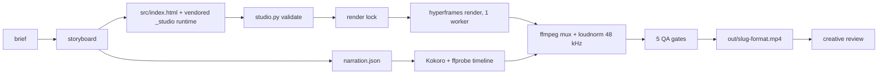

# Motion Lab

A local, low-memory pipeline that turns a project folder (`projects/<slug>/`) into narrated explainers and short-form videos on one Apple Silicon Mac. Everything runs on the machine (GSAP and fonts are fetched from the network at render time, see section 12): HyperFrames (headless Chrome) renders HTML + GSAP + SVG, Kokoro speaks the narration, FFmpeg assembles the result, and scripted gates check it.

Evidence labels used below: **Verified** (read in the workspace), **Observed** (executed and measured), **Inferred**, **Unknown**. Full evidence, per-finding detail and Mermaid diagrams: [docs/architecture-audit.md](docs/architecture-audit.md). Business goals: [docs/VISION.md](docs/VISION.md). Hard production rules: [AGENTS.md](AGENTS.md). Design reference: [ARCHITECTURE.md](ARCHITECTURE.md) section 0. Agent entry point: [CLAUDE.md](CLAUDE.md).

## 1. Project overview

Purpose (VISION.md): produce our own narrated explainers and short-form social videos in technology, finance, science, history, mathematics and news. Motion graphics only, synthetic narration, local rendering, portrait by default. Quality is premium craft plus accurate explanation; speed is not a priority.

Shipped (Verified, `out/*.mp4`, ffprobe): `bhopal-gas-tragedy` (portrait, 104.5 s), `polya-recurrence` (portrait, 73 s), `great-fire-london-collage` (landscape, 44.6 s), `ocean-descent-documentary` (landscape, 49.5 s), plus two silent 14 s landscape fixtures (`motion-quality-v1-baseline`, `-v2-directed`). Older explainers (`btree-database-indexing`, `distributed-consensus-raft`, `neural-network-learning`, `masala-chai`, `paper-plane-field-notes`, `china-market-crash`) live as versioned folders without a top-level `project.json`.

## 2. Workspace capabilities

| Capability | State |
|---|---|
| Multi-format layout composed per format (landscape 1280×720, portrait 720×1280, square 1080×1080, 30 fps) | Verified in `specs/format-presets.json`; shipped films use one format each |
| Deterministic runtime: seeded RNG, one paused GSAP timeline, lint bans `Math.random`, timers, infinite repeats | Verified (`studio.py validate`) |
| Narration: Kokoro, 24 kHz mono, measured durations, 0.5 s scene pauses | Verified in code; not re-run in this audit |
| Capability catalogue: 10 libraries, 43 effects, 44 recipes, 16 primitives, 14 compositions, 10 styles, 42 reference techniques | Verified; **most are `experimental`** (10/10 styles, 37/43 effects) |
| Creative-intelligence layer: beat maps, style bake-off, design knowledge base, asset engine, single-scene re-render | Verified; **not yet committed to git** |
| Technical QA: 5 gates with per-format expectations; objective/measured/judgment motion QA; 12-criterion creative review | Verified and exercised |
| Series (sequential or collection) grouping | Verified (`studio.py series`) |
| Math-animation toolkit (3Blue1Brown style) | **Missing**: only SVG + GSAP primitives; three.js is registered but experimental |
| Preview frame review (Playwright) | **Unavailable on this host** (Playwright not installed) |

## 3. Verified technology stack

| Layer | Tool | Version / location |
|---|---|---|
| Renderer | HyperFrames | 0.8.226, global npm; Chrome from `~/.cache/hyperframes` |
| Animation | GSAP | 3.12.5, loaded from cdnjs at render time |
| Narration | Kokoro | 0.9.4, Homebrew `python3.12` (not the venv) |
| Assembly, QA | FFmpeg / ffprobe | 9.0.2 |
| Acoustic QA, SFX | Earshot | 0.4.0 (`tools/earshot` submodule, installed in `.venv`) |
| Sound library | Openverse (keyless), Clipwing skills (`tools/clipwing-skills` submodule) | |
| Python | `.venv` 3.12.16 (torch, numpy, scipy, librosa, Pillow, jsonschema, earshot) | `python3` on PATH is 3.14: do not use it for ML |
| Node | 24.22.1 | |
| Not installed | Playwright, ruff, pytest, misaki (in `.venv`) | |

No lockfile exists. `pyproject.toml` does not declare kokoro, misaki or playwright.

## 4. Architecture overview



Two tracks share one toolchain: **studio projects** (`project.json`, driven by `scripts/studio.py`) and **legacy projects** (no `project.json`, driven by `scripts/build-project.sh`). Each delegates to the other for the other's kind, so keep both working.

## 5. Pipeline execution flow

Studio project: `brief.json` → optional `research.json`/`research.md` (only when `brief.research.required`) → `storyboard.json` → `src/narration.json` and `audio/` → `src/index.html` (+ generated `index.<format>.html`) → `validate` → `build` → `review`.

`studio.py build` plan (Verified, `build_plan`): validate → formats → narration (skipped if `narration-full.wav` exists) → lint → per format: render → mux → QA → copy to `out/`. The whole build now runs under the render lock.

Legacy stages 0 to 9 (research dossier, narration, composition, foley, lint, render, mux, QA) are unchanged; see ARCHITECTURE.md.

## 6. Directory structure

```text
.
├── CLAUDE.md AGENTS.md ARCHITECTURE.md TODO.md   # agent rules, design reference, open decisions
├── docs/                 # VISION.md (business), architecture-audit.md (evidence)
├── specs/                # JSON schemas (brief, storyboard, project, beatmap, asset…), categories, presets, guides
├── catalogue/            # data/ (records) + schemas/ + index.json
├── src/
│   ├── studio/           # canonical runtime (core, draw, type, motion, compositions, styles/)
│   └── pipeline/         # tts.py, colour science, archetypes, videoscan, asset providers
├── scripts/              # studio.py, session-guard.py, build-audio.py, motion-qa.py, frame-review.py, …
├── templates/            # project templates + research template
├── projects/<slug>/      # brief, storyboard, src/, audio/, qa/, renders/ (gitignored)
├── series/               # series.json groupings
├── out/                  # delivered videos only: MP4s, archive/ of superseded ones, gallery index.html
├── reference/            # reference-video material, never delivered: analysis/ (frames, sheets), design-dna/, design-kb/ (all gitignored, regenerable)
├── tools/                # earshot, clipwing-skills (git submodules)
├── assets/ logs/ archive/ tests/
├── .claude/skills/       # 28 agent skills
├── .locks/ .worktrees/   # lock files; parallel-session worktrees (gitignored)
└── .venv/                # Python 3.12 environment (gitignored)
```

## 7. Component responsibilities

| Component | Owns |
|---|---|
| `scripts/studio.py` | project lifecycle, validation, build plan and execution, review rubric, series |
| `src/studio/` | the composition runtime; copied into each project by `studio.py sync` and SHA-locked |
| `catalogue/` + `motion-catalogue.py` | what capabilities exist and their approval state |
| `scripts/build-audio.py`, `src/pipeline/tts.py` | narration synthesis and timeline |
| `scripts/session-guard.py` | locks (`render`, `tts`, `analysis`) and worktree sessions |
| `.claude/skills/video-assembler/scripts/run-qa-gates.sh` | technical QA gates |
| `scripts/motion-qa.py`, `frame-review.py` | measured motion QA and preview checks |
| `.claude/skills/workspace-steward` + `workspace-governance.py` | placement policy and drift detection |

## 8. Execution and development workflow

Setup once: `git submodule update --init --recursive && source .venv/bin/activate && pip install -e tools/earshot`.

```bash
python scripts/studio.py new <slug> --template illustrated-explainer --formats portrait --category history
python scripts/studio.py validate <slug>
python scripts/studio.py build <slug> --dry-run      # plan only, runs anywhere
python scripts/studio.py build <slug>                # render host: takes the render lock itself
python scripts/studio.py review <slug> --init        # then score qa/creative-review.json
```

Use `.venv/bin/python` for these. Legacy: `./scripts/build-project.sh <slug>`. Catalogue: `python scripts/motion-catalogue.py search "<intent>"`. Governance after any component change: `python scripts/workspace-governance.py`.

Build behaviour to know (Verified in this audit, scratch build): a render whose composition tree, assets, format, fps or quality changed since it was rendered prints `[stale]` and re-renders. A render with no `visuals.stamp.json` (made before stamps existed) is reused with a message; delete it to force a re-render. Narration is still reused whenever `narration-full.wav` exists, so delete it after editing `narration.json`.

## 9. Concurrency model

One heavy job at a time (permanent: VISION.md fixes the 8 GB machine). `session-guard.py` holds `fcntl.flock` locks in one `.locks/` directory shared by every worktree. `studio.py build` acquires the `render` lock itself and is re-entrant under `session-guard build`. Parallel sessions use `session-guard.py session-start <slug>` (git worktree per film). Parallel work helps authoring and validation, not rendering.

Still unlocked when called directly (Verified): `scripts/build-audio.py`, `scripts/frame-review.py`, `scripts/build-project.sh`. Route them through `session-guard.py run <resource> -- …`. Each film is a single `index.html`, so two people cannot work on different scenes of one film without merging.

## 10. Cost and resource considerations

No paid API is called by the pipeline (Verified by grep). `src/pipeline/assets/providers/kie.py` is an opt-in paid-asset adapter, tested only against a local stub, key read from the environment. Cost is local compute and disk.

Measured (Observed): a 14 s 720p30 render takes 22 s wall with a peak of 686 MB across the render process tree. Prior notes put Kokoro at about 1.4 GB and a 50 s film build at 620 to 830 MB. Heavy-film render times are **Unknown**; each build now appends per-stage seconds to `logs/build-timings.jsonl`.

Disk: repo 2.7 GB (`.venv` 1.1 GB, `tools/` 887 MB, `projects/` 476 MB, `out/` 143 MB, `.git` 121 MB), plus 240 MB in `~/.cache/hyperframes`. No cleanup policy exists.

## 11. Quality assurance mechanisms

| Layer | Mechanism | State |
|---|---|---|
| Static | `studio.py validate`: schemas, cross-references, determinism lint, runtime integrity | Works, 0.1 s |
| Preview | `frame-review.py` (clipped text, safe area, contrast, dead stretches) | **Cannot run here: no Playwright** |
| Measured | `motion-qa.py` (objective / measured / judgment; never a quality verdict) | Works |
| Technical | `run-qa-gates.sh`: streams, EBU R128, black gaps, bitrate, Earshot; `--expect-width/height/fps/duration/lufs` | Works |
| Creative | `qa/creative-review.json`, 12 criteria 1 to 5, pass if all ≥ 3 and mean ≥ 3.5, evidence required | Works; judgment is the reviewer's |
| Tests | 147 tests in 6 passing suites; runtime suite skipped (no Playwright) | `test-audio-stack` fails (below) |

Missing: automated audio/picture sync check, scene-repetition detection, factual verification of narration, CI.

## 12. Known limitations

- `test-audio-stack.py` fails: suite 3 (real-sfx) extracts 0 moments from its fixture, then crashes with `FileNotFoundError`. Pre-existing; not investigated further.
- SFX and bed audio are written per film (`generate_bed_and_sfx.py`, three divergent copies).
- GSAP and fonts are fetched from the network at render time.
- Runtime version label (`1.0.0`) is not bumped when content changes: 12 project folders carry a vendored runtime that differs from canonical under the same label.
- The four shipped narrated films have 96 kHz AAC audio (fixed for new builds, shipped files not re-muxed).
- `ruff` and `pytest` are not installed, so the documented lint did not run.
- 10 of 10 styles and most effects are `experimental`; promotion needs render-host evidence.

## 13. Scalability assessment

| Dimension | Assessment |
|---|---|
| More projects | File-based and cheap; storage grows linearly and `out/` duplicates every render |
| Longer videos | Worked to 104.5 s (one sample); render cost per second of video measured on a light 14 s fixture only |
| 1080p / 60 fps / 4K | Defined in presets, **untested** here |
| More complex animation | Not measured; render time is accepted by policy, memory is bounded by one worker |
| More workers | Not supported by design (8 GB) |
| More styles / categories | Easy for categories (JSON); styles touch a record, a CSS file and tags; "what is a style" is an open decision in `TODO.md` |

## 14. Weighted architecture scorecard

Scores are judgements from the evidence in the audit, not measurements. Overall **5.95 / 10** after this audit, **5.77** as found.

| Rubric | Score | Weight | Confidence | Key finding |
|---|---:|---:|---|---|
| A Cost efficiency | 7 | 10% | Medium | No paid calls; agent-session token cost unknown |
| B Execution efficiency | 6 | 10% | Medium | 1.6× real time on a light fixture; serial by design |
| C Concurrent development | 5 | 10% | Medium | Lock now shared across worktrees and enforced in build; three entry points still unlocked |
| D Visual diversity | 6 | 10% | Medium | Four distinct style systems shipped, but styles are token sheets and all experimental; frames not reviewed here |
| E Scalability | 5 | 12% | Low | One long sample; higher resolutions untested |
| F Modularity | 6 | 8% | Medium | Good schemas and boundaries; `studio.py` monolith, hard-wired renderer |
| G Maintainability | 6 | 8% | Medium | Strong tests and docs; overlapping instruction files; lint tooling absent |
| H Reliability | 6 | 8% | Medium | Stage-fail-stop and resume; stale-render bug fixed; no retries |
| I Quality assurance | 7 | 10% | High | Layered gates; preview layer dead on this host |
| J Resource management | 7 | 5% | Medium | Serial locks, 686 MB measured peak; no cleanup policy |
| K Extensibility | 6 | 5% | Medium | Formats and categories easy; renderer and TTS hard-wired |
| L Reproducibility | 4 | 4% | High | Work untracked in git, no lockfile, network at render time |
| **Weighted total** | **5.95** | 100% | | |

## 15. Top architectural risks

1. **Work not under version control** (Critical): most of the creative layer and 5 of 6 films are untracked. One bad command loses them.
2. **No pinned environment** (High): three Pythons, no lockfile, kokoro and playwright undeclared.
3. **Preview QA unavailable** (High): the layer that catches clipped text and safe-area violations cannot run here.
4. **Advisory locking** (High, partly fixed): direct calls to audio, frame-review and legacy build skip the lock.
5. **Network-dependent renders** (Medium): an offline render host or a CDN change breaks reproduction.

Full list of ten with priorities: [docs/architecture-audit.md](docs/architecture-audit.md) section 4.

## 16. Improvements implemented (this audit)

- Render lock shared across git worktrees; re-entrant for nested calls; `studio.py build` takes it.
- Render stamps: stale renders re-render; unstamped legacy renders are kept with a message.
- `aresample=48000` after `loudnorm` (was 96 kHz output).
- Per-stage timing log `logs/build-timings.jsonl` (gitignored).
- Runtime-drift warning names the differing files.
- `categories` backfilled in the 6 studio briefs.
- 5 regression tests (`tests/test-studio.py`: 25 → 30).
- This README (the previous one described projects that no longer exist) and `docs/architecture-audit.md`.

## 17. Recommended future improvements

In priority order: **commit the untracked work** (user action); add a pinned requirements file and a `studio.py doctor` toolchain check; install Playwright or port `frame-review.py` to the puppeteer-core that `dom-probe.mjs` already uses; fingerprint narration like renders; lock `build-audio.py`, `frame-review.py` and `build-project.sh`; derive the runtime version from content; decide the GSAP/font vendoring question; settle "what is a style" (`TODO.md`) before adding styles. Proposals only, none started: splitting `studio.py`, CI, a math-animation toolkit.

## 18. Validation results

| Check | Result |
|---|---|
| `test-studio` (30), `test-motion-catalogue` (16), `test-motion-primitives` (8), `test-workspace-governance` (15), `test-creative-intelligence` (54), `test-reference-corpus` (24, 1 skipped) | OK |
| `test-studio-runtime` | 2 skipped (no Playwright) |
| `test-audio-stack` | **FAIL** (pre-existing, see section 12) |
| `motion-catalogue.py validate`, `workspace-governance.py` (7 gates) | PASS |
| `studio.py validate` on 6 studio projects | 6 × PASS, category warnings 6 → 0 |
| Scratch build of the 14 s fixture | render 21.0 s; skip on unchanged, `[stale]` on edit, `[skip]` without stamp; scratch files removed |
| Mux sample rate | 96,000 Hz → 48,000 Hz on a 5 s clip |
| Not tested | narrated build with `loudnorm` end to end, Kokoro, real two-session contention, multi-format build, frame-review, `ruff` |

## 19. Last audit date

2026-11-02 (host: Apple M2, 8 GB; HyperFrames 0.8.226; FFmpeg 9.0.2).

---

## Constraints worth repeating

- One render at a time. Always `--low-memory-mode` and `< /dev/null`. Never run concurrent HyperFrames, headless Chrome or Kokoro jobs.
- TTS only through `src/pipeline/tts.py` or `scripts/build-audio.py`.
- Never edit `src/_studio/`; edit `src/studio/` and run `studio.py sync`.
- Render duration is not a constraint; do not cut visual density to save time.
- Never commit secrets. Reference videos stay outside the repo; learn techniques, never assets. Reference-derived caches live in `reference/`, never in `out/`.

## Open-source credits

Motion Lab's own code, scripts, skills and docs are MIT licensed.

| Tool | Maintainer | License |
|---|---|---|
| [Kokoro TTS](https://huggingface.co/hexgrad/Kokoro-82M), [Misaki](https://github.com/hexgrad/misaki) | hexgrad | Apache-2.0 |
| [eSpeak NG](https://github.com/espeak-ng/espeak-ng) | eSpeak NG Team | GPLv3 |
| [HyperFrames](https://hyperframes.dev) | HyperFrames Team | MIT / CLI |
| [GSAP 3](https://gsap.com) | GreenSock / Webflow | GreenSock Standard "No-Charge" |
| [Earshot](https://github.com/Leonxlnx/earshot) | Leon (@Leonxlnx) | MIT |
| [Clipwing Skills](https://github.com/Clipwing/skills) | Clipwing Team | MIT |
| [Openverse](https://openverse.org) | WordPress Foundation | CC-licensed metadata (CC0 / CC BY assets, attribution logged) |
| [FFmpeg](https://ffmpeg.org) | FFmpeg Developers | LGPLv2.1+ / GPLv2+ |
| [Three.js](https://threejs.org), [Anime.js](https://animejs.com) | mrdoob & contributors, Julian Garnier | MIT (registered in the catalogue) |
| SoundFile, SciPy, NumPy | their developers | BSD-3-Clause |
| jsonschema | Julian Berman | MIT |
