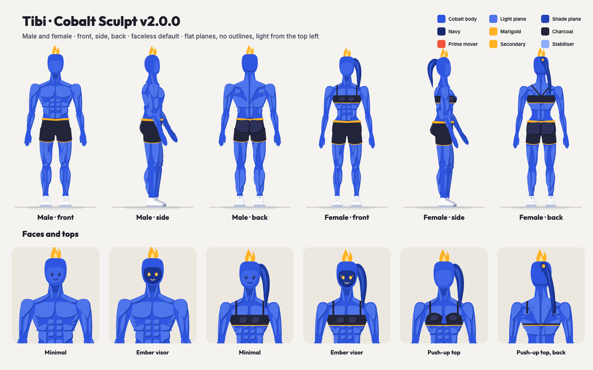
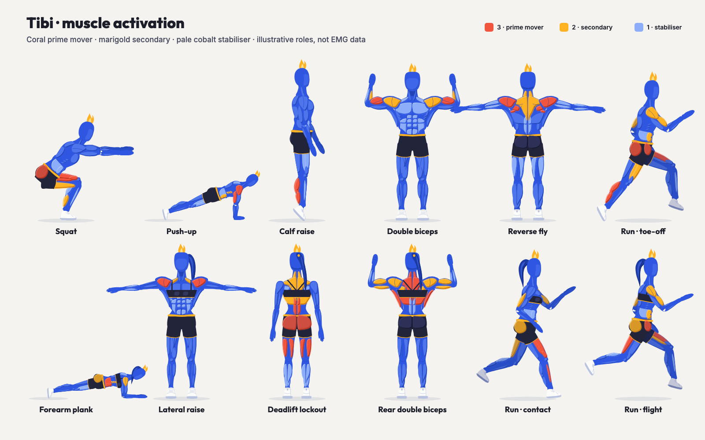
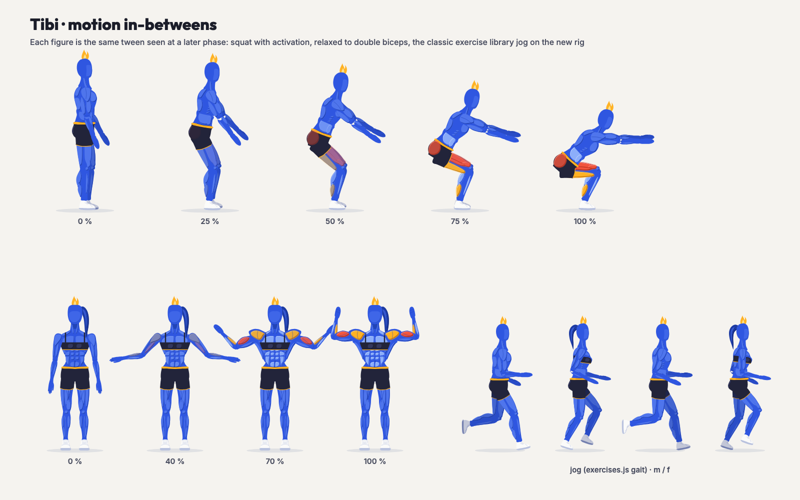
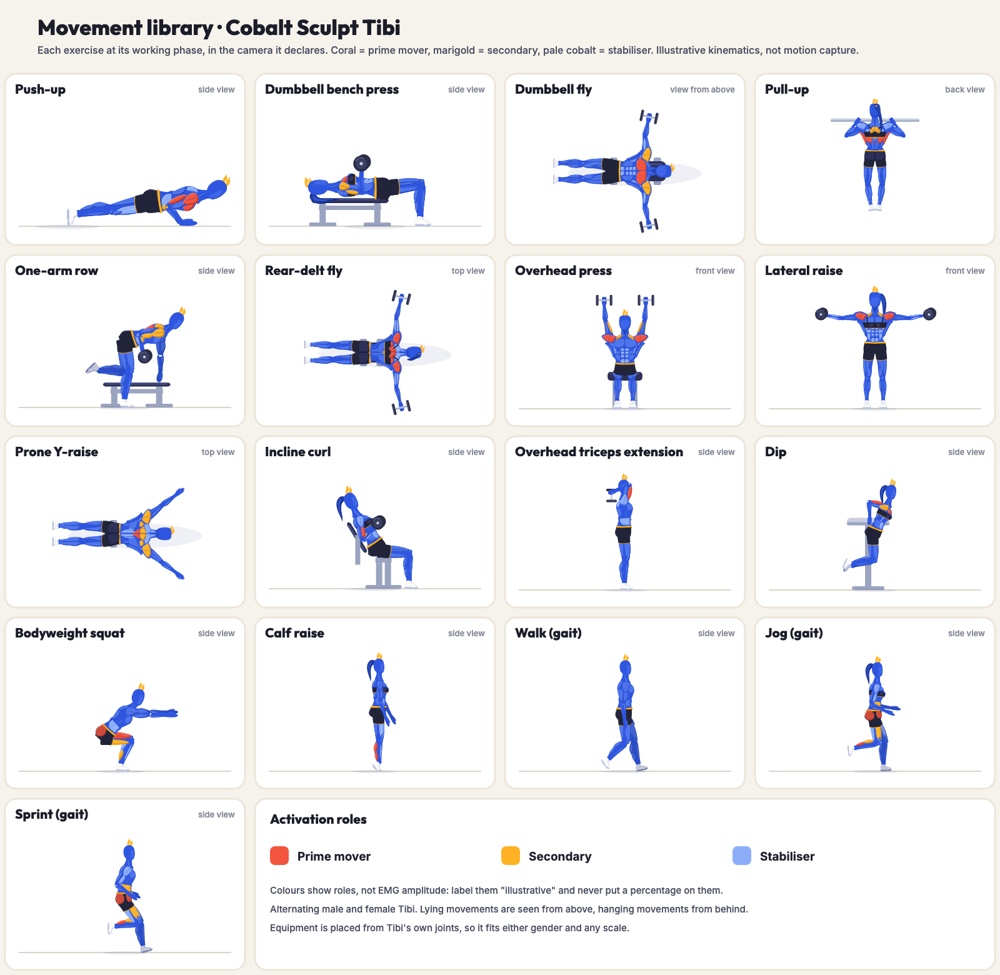
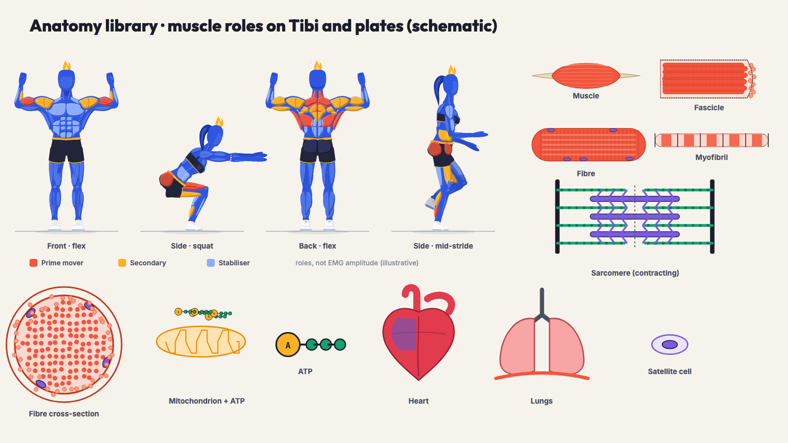
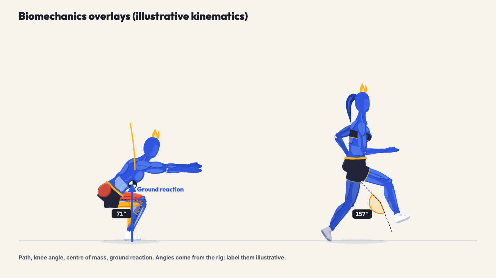
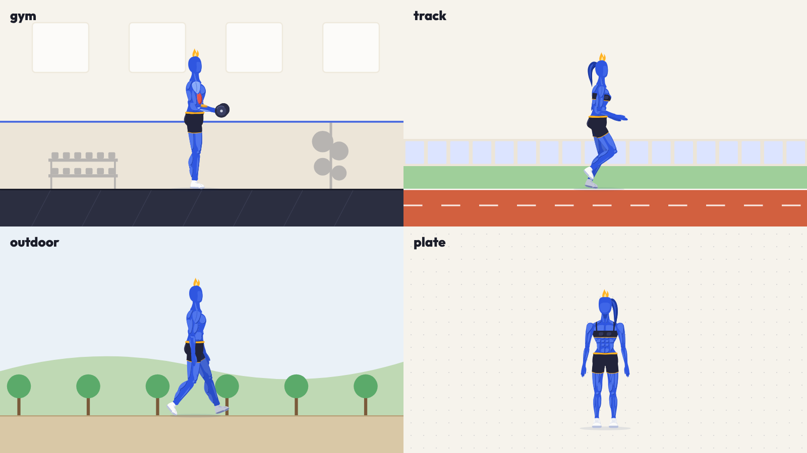
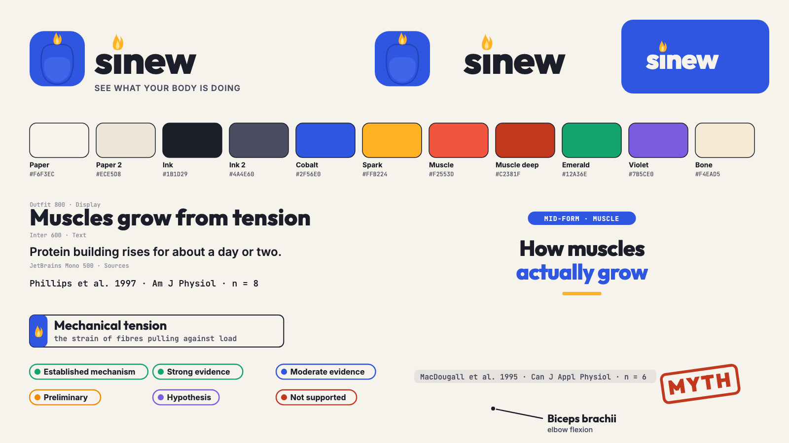
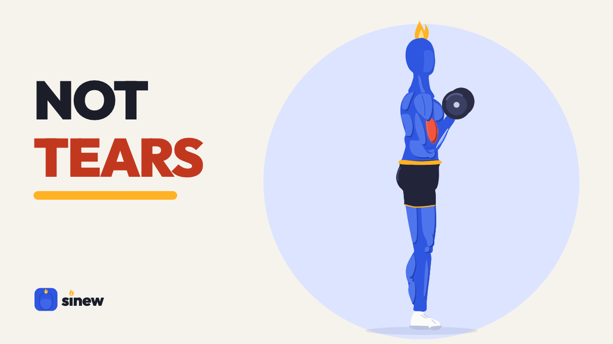

# Sinew fitness asset library

Machine-readable manifest: `manifest.json` (schema `specs/fitness-asset-spec.json`, check `python3.12 scripts/fitness.py check`). Licences and evaluated sources: `.claude/skills/fitness/references/source-registry.md`. API: `.claude/skills/fitness/references/visual-systems.md`.

## Layout

| Path | What |
|---|---|
| `manifest.json` | every asset: id, kind, source, licence, files, API, conventions, rigging, preview, usage, accuracy |
| `data/muscles.json`, `data/exercises.json` | anatomy and movement metadata (generated into `src/studio/kits/fitness/library.js` by `fitness.py library`) |
| `sources/free-exercise-db/` | public-domain extract (Unlicense) used to cross-check muscle lists, with its LICENSE |
| `tibi/` | the Cobalt Sculpt Tibi from its Python generator (`src/fitness/tibi/`): `site/tibi_cobalt_sculpt_v6.html` (design review page, every option and control), `svg/figures/` (65 standalone figures), `svg/heads/` (12 heads), `sheets/` (handover contact sheets) |
| `sheets/*.html` | brand boards built from the kit (the editable layout sources) |
| `previews/*.png` | rendered boards (`fitness.py sheets`) |
| `brand/*.svg` | SVG exports: brand board (logo variants, palette, type, graphics), Tibi model sheet, thumbnail template |

The master source of every drawing is code: the Cobalt Sculpt Tibi's Python generator in `src/fitness/tibi/` (exported to `src/studio/kits/fitness/sculpt-data.js` by `fitness.py sculpt`), and `src/studio/kits/fitness/` plus `src/studio/studio-rig.js` for everything else; the SVGs are exports for designers.

## Preview gallery

**Tibi, Cobalt Sculpt (current): model sheet, faces and tops**

**Tibi, Cobalt Sculpt: muscle activation**

**Tibi, Cobalt Sculpt: motion in-betweens on the rig**

**Classic Tibi model sheet (front, side, three-quarter, back; legacy)**

**Expressions**

**Key poses**

**Movement library**

**X-ray layers and anatomy plates**

**Biomechanics overlays**

**Environments**

**Brand board**

**Thumbnail template**

## Inventory (77 assets)

- **anatomy-plate** (12): `anatomy-muscle`, `anatomy-fascicle`, `anatomy-fibre`, `anatomy-myofibril`, `anatomy-sarcomere`, `anatomy-cross-section`, `anatomy-satellite-cell`, `anatomy-mitochondrion`, `anatomy-atp`, `anatomy-heart`, `anatomy-lungs`, `anatomy-zoom-ladder`
- **biomech-overlay** (4): `bio-angle`, `bio-force`, `bio-path`, `bio-com`
- **brand-graphic** (10): `brand-logo`, `brand-title-card`, `brand-lower-third`, `brand-chapter-card`, `brand-evidence-badge`, `brand-citation`, `brand-myth-stamp`, `brand-callout`, `brand-sting`, `brand-end-card`
- **character** (3): `tibi-sculpt-male`, `tibi-sculpt-female`, `tibi-sculpt-exports`
- **character-view** (4, classic): `tibi-front`, `tibi-side`, `tibi-threeq`, `tibi-back`
- **data** (3): `data-muscles`, `data-exercises`, `source-free-exercise-db`
- **environment** (4): `env-gym`, `env-track`, `env-outdoor`, `env-plate`
- **equipment** (8): `equipment-barbell-end`, `equipment-dumbbell-end`, `equipment-dumbbell`, `equipment-bench`, `equipment-rack`, `equipment-pullup-bar`, `equipment-cable-tower`, `equipment-seat`
- **exercise** (14): `exercise-back-squat`, `exercise-deadlift`, `exercise-bench-press`, `exercise-overhead-press`, `exercise-pull-up`, `exercise-push-up`, `exercise-barbell-row`, `exercise-lat-pulldown`, `exercise-biceps-curl`, `exercise-triceps-pushdown`, `exercise-lunge`, `exercise-leg-press`, `exercise-calf-raise`, `exercise-library`
- **expression-set** (2): `tibi-expressions` (classic), `tibi-sculpt-faces`
- **gait** (3): `gait-walk`, `gait-jog`, `gait-sprint`
- **pose-set** (2): `tibi-poses` (classic), `tibi-sculpt-poses`
- **science-chart** (2): `chart-time-series`, `flow-signal`
- **sound** (1): `sound-sinew`
- **style** (1): `style-sinew-lab`
- **template** (1): `brand-thumbnail`
- **xray-layer** (3): `tibi-xray-muscles`, `tibi-xray-skeleton` (classic), `tibi-sculpt-activation`

All assets are original workspace work (commercial use cleared) except `source-free-exercise-db` (public domain, data only).
