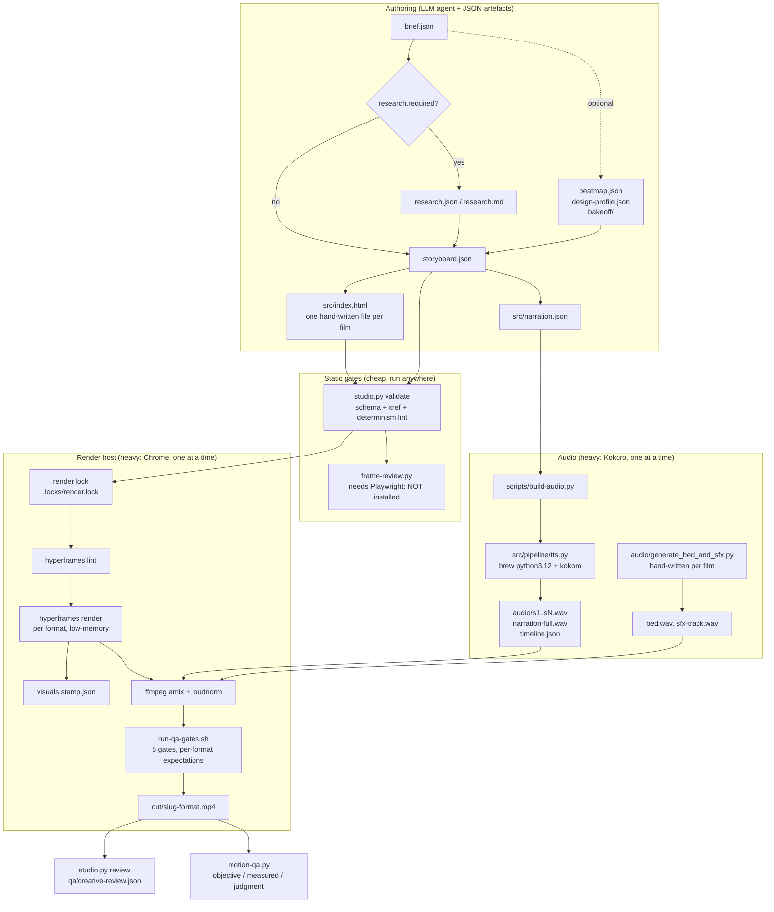
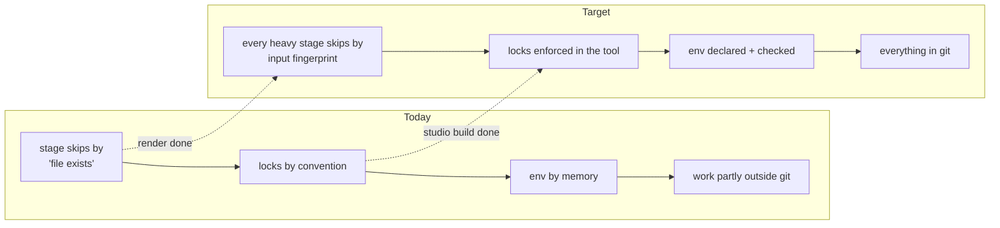

# Architecture Audit, 2026-11-02

Full evidence behind the scorecard in [README.md](../README.md). Every claim carries one of four labels:

- **Verified**: confirmed by reading the file or running a command in this workspace.
- **Observed**: demonstrated by executing something and measuring it.
- **Inferred**: plausible reading, not proven.
- **Unknown**: not enough information.

Host: Apple M2, 8 cores, 8 GB (`sysctl`, Observed). macOS 26.3 (AGENTS.md). 83 GB free disk.

---

## 1. What exists (Phase One)

### 1.1 Execution flow

Two tracks share one toolchain (Verified, `scripts/studio.py:build_plan`, `scripts/build-project.sh:63-76`): studio projects (`project.json`) and legacy projects (no `project.json`). `studio.py build` delegates legacy projects to `build-project.sh`, and `build-project.sh` delegates studio projects back.

### 1.2 Components

| Component | Responsibility | Inputs → outputs | Executes as | Reusable? | Bottleneck? |
|---|---|---|---|---|---|
| `scripts/studio.py` (≈1,450 lines) | Lifecycle CLI: new, sync, formats, validate, build, captions, review, status, series | project folder → plans, validation, builds | Python CLI | Yes | No, but it is the monolith |
| `src/studio/` runtime (6 JS files, 10 CSS styles) | Deterministic composition runtime: format, safe areas, seeded RNG, draw, type, motion, compositions | composition HTML → paused GSAP timeline | Vendored per project into `src/_studio/` with SHA-256 lock | Yes | No |
| `catalogue/` + `scripts/motion-catalogue.py` | Registry of libraries, effects, recipes, primitives, styles, references with approval states | JSON records + schemas → search/validate | Python CLI | Yes | No |
| `scripts/build-audio.py`, `src/pipeline/tts.py` | Kokoro narration, 0.5 s pause buffers, ffprobe-measured timeline | narration.json → WAV + timeline.json | brew `python3.12` (the venv has no kokoro) | Yes | **Yes**: 1.4 GB resident (prior measurement in memory notes, not re-measured) |
| `hyperframes` 0.8.226 (global npm) | Headless-Chrome render of HTML+GSAP to MP4 | index.html → visuals.mp4 | Node + Chrome | Closed external tool | **Yes**: the one serialised heavy stage |
| `run-qa-gates.sh` | 5 technical gates with `--expect-*` flags | final.mp4 → pass/fail | bash + ffprobe + earshot | Yes | No |
| `scripts/motion-qa.py`, `dom-probe.mjs` | Objective / measured / judgment findings, contact sheets, DOM probe | composition + video → report | Python + puppeteer-core from the hyperframes install | Yes | No |
| `scripts/frame-review.py` | Playwright preview checks: clipped text, safe area, contrast, dead stretches | composition → contact sheets | Python + Playwright | Yes | **Not runnable here**: Playwright is in neither interpreter |
| `scripts/session-guard.py` | `fcntl.flock` locks for render, tts, analysis; git-worktree sessions | any command → serialised | Python CLI | Yes | No |
| `scripts/beatmap.py`, `bakeoff.py`, `design-dna.py`, `assets.py`, `scene-revise.py` | Creative-intelligence layer: arcs, style bake-off, design knowledge base, asset engine, single-scene re-render | brief → beat map, profiles, assets | Python CLIs | Yes | No. **Untracked in git** (see finding 1) |
| `.claude/skills/` (28) | Agent workflows and references | prose | read by the agent | n/a | No |
| `projects/<slug>/audio/generate_bed_and_sfx.py` | Hand-written bed and SFX synthesis | script → WAV | Python | **No**: three divergent copies (211, 100, 95 lines) | No |

### 1.3 What does not exist (checked)

- No CI (`.github/` holds only `copilot-instructions.md`).
- No dependency lockfile: no `uv.lock`, `requirements*.txt`, `package.json` or `package-lock.json`.
- No database, no queue, no service. File-based JSON state is the only state, and nothing demonstrated a need for more.
- No calls to a paid API in the pipeline. `src/pipeline/assets/providers/kie.py` is a paid-API adapter that reads its key from the environment and has been tested only against a local stub (its docstring says never to run it live without the user's key and approval).
- No agents defined in the repo; "agents" are Claude Code skills plus CLIs. OpenClaw and Revideo are not wired in (Verified in memory notes; no `revideo` import in `scripts/` or `src/`).

### 1.4 Coupling, duplication, ownership

- Verified: `build_plan` hard-codes `hyperframes` as the only renderer and ffmpeg as the only muxer.
- Verified: `src/pipeline/tts.py` hard-codes the `kokoro-smart-tts-skill` path under `.claude/skills/`, so a skills move (the in-flight `.agents` → `.claude` migration) breaks TTS.
- Verified: guidance is duplicated across `CLAUDE.md`, `AGENTS.md`, `.github/copilot-instructions.md` and `ARCHITECTURE.md` (1,163 lines together). Hard rules (one render at a time, anti-laziness, defaults) appear in three of them.
- Verified: `README.md` was stale before this audit. It listed `projects/benchmark-neural-network` (not present), omitted the studio track's six films, and showed a directory layout that no longer matched.
- Verified: ownership is clear (AGENTS.md says Claude Code owns the repo); the `.agents/` directory is an empty leftover of the user's skills migration, left alone.

---

## 2. Baseline (Phase Two)

### 2.1 Measured (Observed)

| Quantity | Value | How |
|---|---|---|
| Render, 14 s 720p30 landscape fixture (`motion-quality-v1-baseline`), `--quality looks --low-memory-mode` | **22.0 s wall** (HyperFrames reports 19.7 s: capture 18.4 s, setup 0.7 s, compile 0.5 s) → about 1.6× real time | wrapper script, output to scratch |
| Peak memory, same render | **686 MB** summed RSS of hyperframes + Chrome + ffmpeg processes, 1 Hz sampling (21 samples) | `ps` sampler; may miss sub-second spikes |
| Full scripted build stages, same fixture, no audio | validate 0.2 s, lint 0.6 s, render 21.0 s, mux 0.0 s, QA 0.2 s | new `logs/build-timings.jsonl` |
| `studio.py validate`, any film | 0.1 to 0.25 s | `time` |
| `motion-catalogue.py validate` / `workspace-governance.py` | 0.59 s / 0.73 s | `time` |
| Test suites | studio 8 s / 102 MB peak; catalogue 1.3 s; primitives 4.5 s / 213 MB; reference-corpus 0.9 s; governance 1.2 s; creative-intelligence 14 s / 109 MB | `/usr/bin/time -l` |
| Delivered films | 6 files in `out/`, all H.264, all identical to `renders/<fmt>/final.mp4` (md5). Sizes 0.2 to 21 MB; 5.7 to 21 MB for the four narrated films | ffprobe, md5 |
| Delivered audio | **AAC at 96 kHz** in all four narrated films | ffprobe |

Disk (`du`): repo 2.7 GB. `.venv` 1.1 GB, `tools/` 887 MB (earshot alone 851 MB), `projects/` 476 MB (114 MB is `china-market-crash/archive`), `out/` 143 MB, `.git` 121 MB. `~/.cache/hyperframes` holds a further 240 MB outside the repo. `out/` holds a second copy of every render.

### 2.2 Estimated or prior (not re-measured here)

- Kokoro resident memory about 1.4 GB, full 45 to 50 s film build 620 to 830 MB: from the project memory notes (earlier sessions), consistent with the 686 MB measured above.
- Render time for the long, heavy films (bhopal at 104.5 s portrait) is **Unknown**. Nothing recorded it, which is why `logs/build-timings.jsonl` now exists.

### 2.3 Cannot be measured today

Research time, script generation time, scene generation time and asset generation time: all of this is agent work in an LLM session and leaves no pipeline log. Token consumption and API cost per film: **Unknown** (no pipeline API calls; agent-session tokens are outside the repo). TTS wall time: not run, because loading Kokoro costs about 1.4 GB and the answer would not change a decision. Concurrent CPU utilisation: not sampled.

Instrumentation added: per-stage wall time and the largest-single-process RSS per build (`logs/build-timings.jsonl`). The RSS field is the largest child, not a tree sum (it read 246 MB for the render that the tree sampler saw at 686 MB), and is named `max_process_rss_mb` so it is not mistaken for peak memory.

---

## 3. Rubric evidence (Phases Three and Four)

Scores are 1 to 10. "Before" is my judgement of the workspace as found. Weighted overall: **5.77 before, 5.95 after**. This is a judgement score, not a measurement, and the 0.18 movement comes only from items C and H.

| Rubric | W | Before → After | Confidence | Evidence |
|---|---:|---|---|---|
| A Cost efficiency | 10 | 7 → 7 | Medium | No paid calls anywhere in the pipeline (Verified by grep); Kokoro, FFmpeg, Chrome and Openverse (keyless) are local/free. Paid asset generation is opt-in and stub-tested. Cost control as complexity grows is untested, and token cost of agent sessions is **Unknown**. |
| B Execution efficiency | 10 | 6 → 6 | Medium | 1.6× real time on a light fixture. Render is strictly serial by design. Narration is cached per scene. Multi-format builds repeat a full render per format. `scene-revise.py` re-renders one scene. One fixture only; heavy films unmeasured. |
| C Concurrent development | 10 | 4 → 5 | Medium | See finding 4. Locks were per-worktree and bypassed by `studio.py build`; both fixed. Direct `build-audio.py`, `frame-review.py` and `build-project.sh` calls still skip locks. Each film is one `index.html`, so two sessions cannot author different scenes of one film. 8 GB makes real parallel rendering impossible, so parallelism helps authoring and validation only. |
| D Visual diversity | 10 | 6 → 6 | Medium | Four shipped films use four style systems (`editorial-light`, `dark-tech`, `paper-cut`, `cinematic-dark`) with different compositions, and 10 style records exist. But a style is a roughly 40-line token sheet (colours, fonts, one or two motion hints); the real differences come from bespoke per-film HTML. All 10 styles and 37 of 43 effects are `experimental`. No math-animation toolkit beyond SVG and GSAP. I did not watch frames. |
| E Scalability | 12 | 5 → 5 | Low | Duration scaled to 104.5 s once (bhopal). 1080p, 60 fps and 4K are defined in presets but untested here. Linear storage growth with a duplicate copy in `out/`. Per-project vendored runtime copies. One heavy worker. |
| F Modularity | 8 | 6 → 6 | Medium | Good: JSON schemas as interfaces, runtime vs catalogue vs CLIs vs skills. Weak: `studio.py` monolith; renderer and TTS hard-wired; hyphenated script names loaded through `importlib`. |
| G Maintainability | 8 | 6 → 6 | Medium | 147 tests across 6 passing suites; thorough docs. But four overlapping instruction files, a stale README (now rewritten), `ruff` and `pytest` not installed so the documented lint cannot run, and about 280 uncommitted changes mid-migration. |
| H Reliability | 8 | 5 → 6 | Medium | Build stops on first failed stage; per-scene WAVs and `requires_missing` give resume. Before: a stale `visuals.mp4` was silently reused after a composition edit. Now stamped. No retries, no atomic writes for mux, partial-render handling **Unknown**. |
| I Quality assurance | 10 | 7 → 7 | High | Strongest area: determinism lint, schema and cross-reference validation, five per-format gates, objective/measured/judgment taxonomy, 12-criterion creative review that requires evidence. Gaps: frame-review cannot run; no automated audio/picture sync check, scene-repetition detection or factual check; a test suite is failing (finding 10). |
| J Resource management | 5 | 7 → 7 | Medium | `--low-memory-mode`, serial locks, measured 686 MB peak. No watchdog or memory cap, no cleanup policy for `~/.cache/hyperframes`, `out/` or archives. |
| K Extensibility | 5 | 6 → 6 | Medium | New format = a presets entry; new category = a JSON entry; new style = a catalogue record + CSS file + category tags (three places). New renderer or TTS engine = edit `build_plan` and the wrapper. |
| L Reproducibility | 4 | 4 → 4 | High | Good: vendored runtime with SHA lock, seeded PRNG lint, pinned GSAP 3.12.5, committed timelines. Bad: finding 1 (untracked work), finding 2 (no lockfile), GSAP and fonts fetched from the network at render time, runtime version label never bumped. Renders now carry a fingerprint, which helps old projects only from the next render. |

---

## 4. Top architectural weaknesses (Phase Five)

Priority = Impact × Confidence ÷ Effort, each on a 1 to 5 scale (5 = highest impact / most certain / most effort).

| # | Weakness | Evidence | Sev. | I·C÷E | Status |
|---|---|---|---|---:|---|
| 1 | **Most of the creative layer and 5 of 6 films are not in git.** | `git status`: `??` for `scripts/{assets,bakeoff,beatmap,design-dna,motion-qa,scene-revise}.py`, `dom-probe.mjs`, 9 `specs/` files, 16 `catalogue/data` records, and the project folders for bhopal, polya, great-fire, ocean-descent and both motion-quality films. The last commit is only the bhopal film. | Critical | 5·5÷1 = **25** | **Unresolved**: needs the user to commit; I did not commit |
| 2 | **No dependency lock; three Pythons.** `.venv` (3.12.16: torch, numpy, earshot; no kokoro, no playwright, no ruff, no pytest), Homebrew `python3.12` (kokoro 0.9.4, torch), Homebrew `python3` = 3.14. `pyproject.toml` lists none of kokoro, misaki or playwright. | `importlib` probes; `pyproject.toml` | High | 4·5÷2 = **10** | Documented in README; lock file **proposed** |
| 3 | **QA layer 1 is dead on this host.** `frame-review.py` and `test-studio-runtime.py` need Playwright. | import probe in both interpreters; 2 runtime tests skipped | High | 4·5÷2 = **10** | **Proposed**: install Playwright, or port to the puppeteer-core that `dom-probe.mjs` already uses |
| 4 | **The one-render-at-a-time rule was advisory and not shared across worktrees.** `LOCK_DIR` derived from `__file__`, so each worktree had a private `.locks/`; `studio.py build` took no lock. | `session-guard.py` (pre-change) and `studio.py:cmd_build` | High | 4·5÷2 = **10** | **Fixed** for worktrees and `studio.py build`; `build-audio.py`, `frame-review.py`, direct `build-project.sh` remain unlocked |
| 5 | **Stale render silently reused.** `requires_missing` skipped the render whenever `visuals.mp4` existed. | `studio.py` (pre-change); project memory notes | High | 4·5÷1 = **20** | **Fixed** (stamp + fingerprint) |
| 6 | **96 kHz delivery audio.** `loudnorm` upsamples; nothing resampled. | ffprobe on 4 shipped films; 5 s test: 96,000 Hz before, 48,000 Hz after the filter fix | Medium | 3·5÷1 = **15** | **Fixed** for future builds; shipped films not re-muxed |
| 7 | **Runtime version label is meaningless.** 12 project folders warn "1.0.0 differs from 1.0.0". | `workspace-governance.py` output | Medium | 3·5÷2 = **7.5** | Message now names the differing files; version bump policy **proposed** |
| 8 | **Render depends on the network.** GSAP from cdnjs, fonts from Google, no integrity hash, no vendored copy. | each film's `src/index.html` (bhopal line 106); `catalogue/data/libraries/gsap.json` | Medium | 3·5÷2 = **7.5** | **Proposed** (vendor needs a licence decision) |
| 9 | **SFX workflow is bespoke per film.** Three divergent `generate_bed_and_sfx.py` files. The automatic cue extraction suite fails: `test-audio-stack.py` suite 3 "Extracted 0 animation moments", then the test crashes with `FileNotFoundError` instead of recording a failure. The test file is also uncommitted-modified by the user, so I left it. | test run; md5 of the three scripts | Medium | 3·4÷3 = **4** | **Unresolved** (pre-existing, not caused by this audit) |
| 10 | **`studio.py` monolith and hard-wired renderer.** | 1,450 lines; `build_plan` | Medium | 3·4÷4 = **3** | **Proposed** only; no demonstrated need to swap renderers |

Also noted, lower priority: instruction-file sprawl (README fixed, the other three left); `out/` duplicates every render; `.agents/` empty directory; all 10 styles still `experimental`; no CI.

---

## 5. Target architecture (Phase Six)

The current architecture is sound for one operator on one machine. The conceptual responsibilities (research, script, visual direction, scene planning, assets, composition, audio, render, QA, orchestration) already map to files and CLIs. **No new modules, services, agents, databases or models are justified by what I found.** The target changes how the existing stages are bound together.

| Concern | Today | Target | Why |
|---|---|---|---|
| Stage caching | render fingerprint (done); narration, mux and QA keyed on file existence or always re-run | extend the same fingerprint idea to narration (narration.json + voice + speed), one `build-manifest` per format | stale narration after a script edit is the same bug as the stale render |
| Locking | enforced in `studio.py build` only | one `acquire_lock` call in `build-audio.py`, `frame-review.py` and `build-project.sh` (through `session-guard.py run`) | closes the remaining bypasses; no behaviour change when uncontended |
| Environment | tribal knowledge + memory notes | `docs/` snapshot (below) → pinned requirements file → `studio.py doctor` that reports the toolchain | prevents the "which Python" and "no Playwright" surprises |
| Style system | token sheet + catalogue record + category tags | unchanged until `TODO.md` settles "what is a style" | the open decision blocks any safe change |
| `studio.py` | one file | split into `studio/` package (lifecycle, validate, build, series) only when a second renderer or a CI job needs it | no current pain justifies the churn |
| Render concurrency | 1 | stays 1 (VISION.md: hardware fixed) | parallel render is not a goal on 8 GB |

Migration: (1) commit the untracked work (user action). (2) Add the pinned requirements file and `doctor`. (3) Extend fingerprints to narration. (4) Lock the remaining entry points. (5) Revisit the `studio.py` split. Each step is independently shippable and none changes a film's output.

Risks: fingerprints can mark a render stale when only an irrelevant asset changed (cost: one extra render, which VISION.md says is acceptable); a pinned requirements file can drift from the two real environments if not regenerated.

### Verified environment snapshot (2026-11-02)

| Tool | Version | Where |
|---|---|---|
| Python | 3.12.16 | `.venv` (torch 2.15.0, numpy 2.5.4, scipy 1.18.1, librosa 1.0.0, soundfile 0.14.0, Pillow 13.0.0, jsonschema 4.26.0, transformers 5.22.0, earshot 0.4.0) |
| Python | 3.12.x | Homebrew `python3.12`: kokoro 0.9.4, torch 2.15.0 (used by TTS) |
| Python | 3.14 | Homebrew `python3` (the default `python3`; avoid for ML) |
| HyperFrames | 0.8.226 | global npm |
| FFmpeg | 9.0.2 | Homebrew |
| Node | 24.22.1 | Homebrew |
| GSAP | 3.12.5 | cdnjs at render time |
| Missing | playwright, ruff, pytest, misaki (in `.venv`) | |

---

## 6. Changes (Phases Seven and Eight)

### Implemented

| Cat. | Change | Files | Verified by |
|---|---|---|---|
| B | Render lock shared across git worktrees (resolved through `git rev-parse --git-common-dir`; `MOTION_LAB_LOCK_DIR` overrides) | `scripts/session-guard.py` | unit test with a real temp git worktree |
| B | Lock re-entrancy through `MOTION_LAB_LOCKS_HELD`, so `session-guard build` → `studio.py build` does not deadlock | `scripts/session-guard.py` | unit test: child process acquires, an unrelated process times out |
| B | `studio.py build` takes the render lock itself (studio and legacy paths) | `scripts/studio.py` | scratch build acquired and released it once |
| B | Render stamps: `visuals.stamp.json` fingerprints composition tree + assets + format + fps + quality; stale renders re-render, unstamped legacy renders are kept with a message | `scripts/studio.py` | unit tests; scratch build: run 1 render, run 2 skip, run 3 `[stale]` re-render, stamp removed → `[skip] … no build stamp` |
| A | `aresample=48000` after `loudnorm` in the mux | `scripts/studio.py` | plan test + isolated ffmpeg: 96,000 → 48,000 Hz |
| A | Per-stage wall time and RSS written to `logs/build-timings.jsonl` (gitignored) | `scripts/studio.py` | scratch build |
| A | Runtime-drift warning names the differing files | `scripts/studio.py` | governance output |
| A | `categories` backfilled in 6 briefs (history+storytelling, mathematics, history, science, technology ×2); clears the 6 "no categories" warnings listed in `TODO.md` | `projects/*/brief.json` | `studio.py validate`: 6 × PASS, 0 category warnings |
| A | 5 new regression tests | `tests/test-studio.py` | 25 → 30 tests, all OK |
| A | Reference material moved out of `out/` into `reference/` (`analysis/`, `design-dna/`, `design-kb/`); 25 files re-pointed | `scripts/reference-corpus.py`, `scripts/design-dna.py`, `.gitignore`, docs, skills, catalogue records | catalogue validate, governance, 4 test suites, `design-dna.py kb build` writes to the new path |
| A | This audit and the README rewrite | `docs/architecture-audit.md`, `README.md` | `workspace-governance.py` PASS |

### Deliberately not implemented

- Committing anything (no instruction to commit; finding 1 needs the user).
- Installing Playwright or Chromium (new dependency plus download, finding 3).
- Re-muxing the four shipped films at 48 kHz (would overwrite deliverables).
- Vendoring GSAP (licence decision; Category C-adjacent).
- Splitting `studio.py`, replacing the renderer, adding CI (no demonstrated need or Category C).
- Fixing `tests/test-audio-stack.py` (uncommitted user edits in that file; suite 3 failure pre-dates this audit).
- Locking `build-audio.py` / `frame-review.py` directly (not yet done; listed as next step).
- Touching the in-flight `.agents` → `.claude` migration.

### Validation

| Check | Result |
|---|---|
| `tests/test-studio.py` | 30 OK (was 25) |
| `test-motion-catalogue` / `test-motion-primitives` / `test-workspace-governance` / `test-creative-intelligence` | 16 / 8 / 15 / 54 OK |
| `test-reference-corpus` | 24 run, 1 skipped, OK |
| `test-studio-runtime` | 2 skipped (no Playwright) |
| `test-audio-stack` | **FAIL**, pre-existing: suite 3 extracts 0 moments, then raises `FileNotFoundError` |
| `motion-catalogue.py validate` | PASS |
| `workspace-governance.py` | PASS, 7 gates |
| `studio.py validate` on the six studio projects | 6 × PASS, 0 category warnings |
| `studio.py build --dry-run` | plan prints |
| `ruff check` | **not run**: ruff is not installed |
| Not tested | narrated end-to-end build with `loudnorm` (the 48 kHz fix is proven on a 5 s clip and in the plan, not on a full film); Kokoro synthesis; true two-session contention; multi-format build; frame-review |

## Follow-up 2026-11-05: parallel sessions

Closes the concurrency gaps left open by finding 4 (`docs/architecture-audit.md` score row C), so any number of worktree sessions can run:

- **One host lock.** `render`, `tts` and `analysis` shared no lock with each other, so a Kokoro job (1.4 GB) and a render (0.8 GB) could overlap, and `studio.py build` ran its narration stage under the render lock only. All three now map to one `heavy` flock in `.locks/`.
- **FIFO queue** (`.locks/queue/`) with dead-waiter pruning replaces the unordered race; `status` lists holder and queue. A job that dies frees the lock itself, and SIGTERM/SIGHUP/SIGINT on a holder first kills its process tree (Chrome detaches into its own process group), so a killed agent no longer leaves an unguarded render running.
- **No unlocked heavy entry points left** among the repo's own scripts: `build-audio.py`, `src/pipeline/tts.py`, `frame-review.py`, `reference-corpus.py doctor|analyze|strip` and the render stage of `build-project.sh`/`render.sh` take the lock through `src/pipeline/hostlock.py`. Raw `hyperframes`/browser calls by hand are still unguarded by construction.
- **Worktree lifecycle.** `session-end` copies gitignored renders, audio and `out/*.mp4` into the main checkout before removing the worktree (they were deleted with it), refuses a conflicting `--merge` before touching anything and merges with `--no-edit`; `session-list` reports ahead/behind, uncommitted files, unmerged renders, predicted conflicts and lock activity; `session-start` warns about uncommitted tooling that a worktree branched from HEAD will not contain.
- **Evidence:** `tests/test-studio.py SessionGuardTests` (12 cross-process tests, including SIGTERM teardown of a detached grandchild and the older-worktree lock), plus an 8-worktree run in a scratch repo: no overlapping jobs, 8.5 s wall for 8 one-second jobs. Memory headroom on the M2 is the real ceiling and was ~1.4 GB available at the time of measurement; nothing here measured a full multi-session render on this host.
- **Not fixed:** `kill -9` on the guard cannot be intercepted; worktrees made before this change keep the old script (covered for same-resource exclusion by a compatibility lock, see `_take_legacy_lock`).

## Follow-up 2026-11-05: narration currency, partial renders, scene revision

Target-architecture row "Stage caching" (section 5), plus two defects found while reviewing it. All Verified by tests in `tests/test-studio.py` (`NarrationCurrencyTests`, `test_render_goes_to_a_partial_file_…`); none was exercised against real Kokoro or HyperFrames.

| # | Defect | Effect | Fix |
|---|---|---|---|
| 11 | `studio.py build` skipped narration whenever `narration-full.wav` existed, while the render fingerprint covers `src/narration.json`. | An edited script re-rendered the picture but kept the old voice. Compositions hard-code cue times copied from `audio/timeline.json` (e.g. fridge's `var A = {…}`), so even correct re-narration desyncs a film, and every technical QA gate still passes. | `src/pipeline/narration.py` compares `timeline.json` (voice, speed, pause, each scene's text, now also the Kokoro version) with the request. The build re-narrates only when stale, then **stops with exit 3** if any scene start or end moved by more than one frame, listing the shifts (`--allow-narration-shift` overrides). `validate` warns on stale narration. An older timeline that records none of this (china v5) is reused with a note. |
| 12 | `build-audio.py` re-synthesised every scene on every call (the "cached per scene" in row B above was wrong) and overwrote gitignored WAVs. | Full Kokoro run (~1.4 GB) for a one-word edit; no way back to the previous take. | Reuses a scene clip when its id, text, voice, speed and engine match; loads Kokoro only if a scene needs it; copies replaced audio to `audio/history/<when>/` (gitignored). The import-time re-exec into python3.12 moved into `main`. |
| 13 | Nothing checked that narration fits the film. | The mux's `-t duration_sec` silently cut speech that ran long. | `validate` errors when `timeline.json` total exceeds `duration_sec`. All current films fit (1.4–3.9 s headroom; neural-network v3 exactly 0). |
| 14 | HyperFrames wrote straight to `visuals.mp4`. | A killed render could leave a truncated file. Since every render was archived on 2026-11-05, any such file would be stamp-less, i.e. "unstamped", and reused. | Render to `visuals.partial.mp4`; rename on exit 0; exit 0 without a file fails the stage. |
| 15 | `scene-revise.py` called `studio.py build` to re-mux, which saw the edited composition, archived the spliced track as stale and re-rendered the whole film. It also rendered `index.<format>.html` without regenerating it from an edited `index.html`. | The tool never saved a render; a portrait revision could splice in the old scene. | Runs `formats` first, refuses when `src/_studio/` changed or the render is unstamped, and re-stamps the render after the splice with a `spliced` record. `archive_render` now also moves `visuals.prev.mp4`. |

